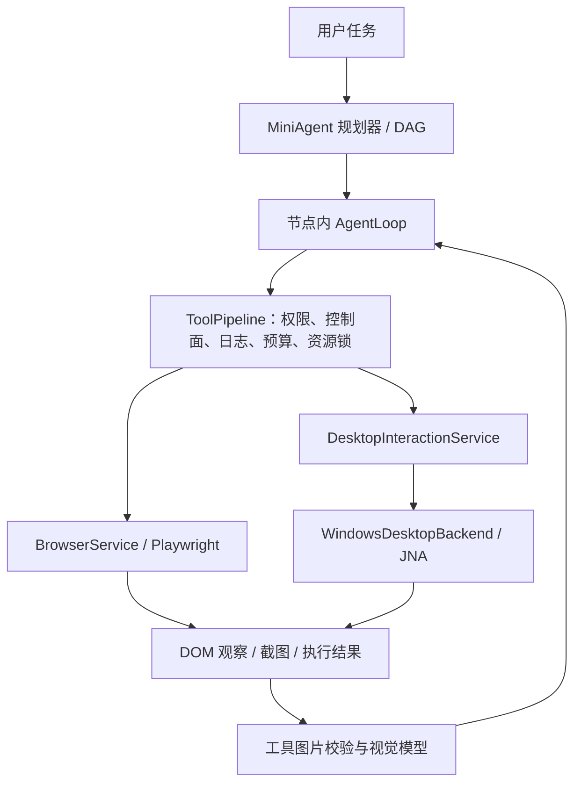

# 桌面与浏览器混合控制

本文描述仓库当前实现及其验证边界。MiniAgent 使用自己的 `AgentLoop`、DAG 规划器和工具执行管道，接入 Windows 原生桌面适配器与 Playwright 浏览器服务。

## 架构与任务拆分



网页任务优先使用浏览器 DOM/ref 工具；桌面软件使用 `desktop` 能力包。选路通过工具能力面和上下文指导交给模型，具体动作仍受工具管道约束。DAG 节点表示“查找资料”“填写表单并核验结果”等业务步骤；节点内部循环执行观察、操作、核验，不把每次截图、点击、按键都拆成长期 DAG 节点。

当前没有接入 Agent S、UI-TARS Desktop、browser-use 等外部完整 Agent 运行时，也不依赖 Codex 的私有电脑控制服务。已有 Java 服务直接承担执行闭环：

| 部件 | 当前职责 |
| --- | --- |
| `GoalCompiler` / `PlanningLoop` | 生成、校验和调度任务节点；`desktop` 是可用能力之一 |
| `AgentLoop` | 在节点内选择工具、接收结果、向模型提供实际截图并核验后续操作 |
| `ToolPipeline` | 权限审批、暂停/取消边界、执行预算、资源互斥、Action Journal |
| `BrowserService` | 单独 actor 线程访问 Playwright，管理会话页面与 DOM 观察引用 |
| `DesktopInteractionService` | 观察 ID、租约、调用者归属、单动作执行与清理 |
| `WindowsDesktopBackend` | JNA 调用 User32/GDI32：窗口枚举、截图、焦点验证与 `SendInput` |

桌面控件目前由视觉模型根据截图定位。尚未实现 Windows UI Automation 无障碍树、macOS 原生适配器或专用本地视觉定位模型；`DesktopBackend` 接口为后续适配保留了替换边界。

## 启用与模型配置

`DesktopInteractionService` 的 `agent.desktop.enabled` 缺省为 `false`。桌面客户端配置 `application-desktop.yml` 明确设置为 `true`，Electron 启动后端时激活 `desktop` profile。普通服务部署不会因为注册了工具就默认取得桌面控制能力；显式配置开启后，仍需要 Windows 10+ 已登录的交互桌面。

```yaml
agent:
  desktop:
    enabled: true
```

Windows 原生实现运行在后端 JVM 内，无独立 Python Agent 或桌面 sidecar。锁屏、非交互服务会话、UAC 安全桌面及权限级别不匹配都可能阻止截图、切换焦点或输入；失败回执不能解释为业务操作成功。

工具截图沿用用户上传图片使用的视觉预设。`ConfiguredToolVisionModelResolver` 根据当前认证用户调用 `ModelClientFactory.resolveForMultimodal`，使用已有 `agent.multimodal.vision-preset` 配置；没有另建一套桌面模型账号或把某个桌面专用模型写死。预设及其服务端必须支持图片输入。

`ToolObservationProjector` 将受信工作目录内的实际图片变成模型的 `ImageContent`。它验证文件归属、图片格式、文件大小与尺寸，拒绝工作目录外的路径、损坏图片等输入。截图中的文字按网页/应用内容处理，不作为新的用户指令。仅在结果里返回一个图片路径，不等于模型已经看到了图。

AgentLoop 在取得本轮可用桌面截图前隐藏 `desktop_act`。续跑时历史工具图片会被移除，须重新观察；截图校验或视觉调用失败时停止后续操作，不允许基于旧图继续猜坐标。历史图片不会无限保留在模型消息中；截图文件仍按会话工作目录的文件管理规则保存。

## 桌面工具契约

| 工具 | 输入与结果 | 执行预算 |
| --- | --- | --- |
| `desktop_observe` | 无目标参数；观察前台窗口，返回截图、窗口列表、一次性 `observationId`、图片尺寸和窗口信息 | 15 秒 |
| `desktop_act` | `observationId` 与单个 `action` 必填；执行后返回新截图和新观察 ID | 10 秒 |
| `desktop_release` | 无任意目标参数；释放当前归属的桌面租约并使旧观察失效 | 5 秒 |

上述预算是工具的默认执行契约；审批、暂停检查点与资源锁等待独立管理。三工具使用同一 `desktop:local-input` 共享资源锁。桌面服务还用租约绑定认证 tenant、user 和 chat，同一 JVM 内的不同会话不能交错控制同一输入设备。观察与租约目前有效期为 120 秒，动作需要最新且尚未消费的观察。

`desktop_act` 支持以下单动作：

| `action` | 参数与约束 |
| --- | --- |
| `click` / `double_click` / `right_click` | `x`、`y` 必填，必须在观察截图范围内 |
| `type` | `text`，每次最多 2048 个 UTF-16 字符；通过 Unicode 输入，不替换用户剪贴板 |
| `key` | `key`，例如 `CTRL+A`、`ENTER`、`TAB`；最多 4 个受支持的按键组合 |
| `scroll` | 非零 `amount`，范围 -10 至 10；正数向下、负数向上；可提供成对的 `x`/`y`，否则定位到窗口中心 |
| `focus` | `targetWindowId` 必须来自本次观察的可见窗口列表 |

`focus` 不能指定观察列表以外的任意窗口。动作通过校验后会消费观察 ID；执行失败或结果不确定时，模型必须重新观察。`inputAccepted=true` 仅表示输入已接收，`verificationRequired=true` 要求继续检查界面，二者均不能证明发送、保存、提交等业务目标已经完成。

## 坐标与动态界面边界

桌面坐标是**当前窗口截图左上角为原点的物理像素**，不是浏览器 CSS 坐标、逻辑屏幕坐标或整块屏幕坐标。Windows 适配器设置线程 DPI 感知，从屏幕 DC 按 `GetWindowRect` 的物理边界截取实际可见画面，包含标题栏；截图与点击使用相同原点。不能用客户区 DC 复制整个窗口尺寸，否则截图尺寸即使一致，按钮位置也会偏移。执行鼠标动作时再加上窗口的屏幕偏移；捕获后再次检查窗口边界。

观察绑定窗口句柄、进程 ID、位置和尺寸。执行前验证窗口身份与几何边界；审批使焦点临时切走时，只尝试恢复已绑定的目标窗口。输入过程中继续检查焦点和窗口边界，鼠标落点及滚动位置还检查是否被其它顶层窗口遮挡。窗口移动、关闭或无法恢复焦点时应重新观察。

这些检查无法冻结应用。**同一个窗口内部的内容可以在截图后变化，而句柄、PID 和边界保持不变。** 当前没有对截图区域做原子锁定或逐像素一致性验证；按钮改名、异步弹出内容、动画与网络刷新都可能改变操作含义。应保持短动作循环，在明显变化、失败或等待后重新观察，并核验动作后的截图。焦点与坐标校验也不能替代视觉模型的识别准确率评估。

上述互斥针对同一个后端进程；当前没有跨 JVM、跨安装实例或跨主机的操作系统级桌面分布式锁。浏览器页面和原生桌面也没有共享 cookie、标签页或桌面窗口状态的自动同步机制。

## 权限、未知结果与生命周期清理

`desktop_observe` 声明为只读、幂等；`desktop_release` 为幂等清理；`desktop_act` 为非幂等外部写操作。桌面工具不做流式预执行，也不自动重试输入。

默认模式、危险操作询问、单独开启自动编辑或自动确认时，`desktop_act` 都需要参数绑定的审批。审批覆盖实际执行的观察 ID 和动作参数，不能用一个坐标或旧观察的授权批准另一次调用。用户显式开启“自动编辑 + 自动确认”的全自动组合，或显式选择会话内始终允许时，沿用产品已有的免批语义。Plan 未批准及只读工具面隐藏桌面动作，允许观察和归属内清理。

生产审批通过 `withApprovalWait()` 保持原工具调用等待，控制器批准 token 后唤醒同一个调用，沿用完整原始参数；不是重新让模型构造一次动作。正常等待审批期间尚未进入任务的最终清理。观察仍独立地在生成后 120 秒过期，审批 token 的默认有效期则为 300 秒：因此界面上的 token 尚未过期，也可能因观察过期而无法执行。此时必须重新观察并重新批准，不把旧批准迁移到新观察 ID；暂停或取消撤销租约后同样需要新观察。当前尚未将审批卡到期时间与观察剩余有效期联动。

点击、按键或输入发生后，超时与取消并不意味着副作用撤销。无法确认已开始动作的终态时，管道记录 `UNKNOWN`，Action Journal 阻止自动重放；后台处理器迟到的成功结果不能覆盖这一终态。恢复时先 `desktop_observe` 检查当前界面，再决定后续动作，不能直接重复发送、点击或输入。

清理同时覆盖工具和应用生命周期：

- 单动作执行 `finally` 释放本实现记录为已按下的键与鼠标按钮；不向其它任务发送任意输入。
- `desktop_release` 使当前任务的观察与租约失效。
- `AgentChatApplicationService.pause/cancel` 撤销该会话的桌面租约并中断活动输入线程；控制存储读写失败时仍尝试撤销。
- 应用执行 `finally` 调用 `releaseFor(userId, tenantId, sessionId)`，覆盖成功、失败、取消、等待人类及启动异常；桌面清理异常单独记录，不覆盖原始任务结果或跳过其它清理。

暂停/取消清理由生命周期代码直接完成。不能依赖模型在任务已暂停或取消后再调用清理工具，因为工具管道自身会在控制检查点阻止继续执行。已经交给操作系统或网站的输入没有回滚保证。

## 浏览器会话与引用

浏览器执行继续使用 Playwright，默认创建 MiniAgent 管理的会话页面；不会自动接管用户正在使用的 Chrome/Edge 标签页或复用其登录态。调用边界从认证 tenant、user 和 chat 生成资源身份；兼容参数 `sessionId=default` 代表当前会话，不代表所有用户共享的浏览器。

DOM 观察返回不透明 ref，例如 `b12.3`，绑定观察中的元素对象。旧的纯行号不再作为可执行 ref。执行时检查 URL、可访问性快照与元素连接状态；动作后取得新观察并使旧 ref 失效。页面变化、节点替换或引用失效返回 `STALE_OBSERVATION`，应重新获取快照；输入框定位必须唯一，不回退到页面第一个输入框。所有 Playwright 对象由同一个 actor 线程访问，首版不承诺独立浏览器 actor 的并行吞吐。

完整会话、DOM/ref、截图和取消契约见 [Browser interaction contract](browser-control-contract.md)。

## 验证方式

以下命令在仓库根目录的 PowerShell 中运行，需要可用的 Java 21+ 和 Maven Wrapper 环境。命令描述可复现的测试入口，测试通过数量以当次 Surefire 报告为准。

### 定向单元回归

```powershell
.\mvnw.cmd -pl mini-agent-app -am test "-Dtest=DesktopInteractionServiceTest,WindowsDesktopInputTest,DesktopToolsTest,ToolConcurrencyPolicyDesktopTest,PermissionPolicyDesktopTest,ToolPipelineDesktopTest,ToolObservationProjectorTest,AgentLoopToolVisionTest,ConfiguredToolVisionModelResolverTest,BrowserSessionIdentityTest,BrowserObservationTest,BuiltinToolsBrowserPolicyTest,AgentChatCancellationTest,AgentChatApplicationServiceLifecycleTest" "-Dsurefire.failIfNoSpecifiedTests=false"
```

这些测试覆盖观察消费、归属隔离、焦点与参数校验、输入释放、审批、预算、未知结果不重放、暂停取消、生命周期清理、图片归属及视觉调用。模型与原生执行边界使用 stub/mock，输入清理测试使用假 `InputSender`，不会向真实桌面发送键鼠。

### Windows 原生集成测试（显式启用）

```powershell
.\mvnw.cmd -pl mini-agent-tools -am test "-Dtest=WindowsDesktopIntegrationTest,WindowsDesktopCaptureIntegrationTest" "-Dsurefire.failIfNoSpecifiedTests=false" "-Dminiagent.desktop.integration=true" "-Djava.awt.headless=false"
```

该测试只在 Windows 且显式设置开关后运行，会创建本测试 JVM 拥有的临时 Swing 窗口，验证真实窗口截图、点击、Unicode 输入与界面结果，然后释放输入并关闭窗口。需在可交互、未锁定桌面运行，测试期间会改变焦点和鼠标位置；它不操作日常应用。未开启开关或非 Windows 时的跳过不算原生验证通过。

`WindowsDesktopCaptureIntegrationTest` 通过独立的 `ClientToScreen` 与原生色块验证截图的物理坐标原点，包括窗口装饰；可用 `-Dminiagent.desktop.expectedDpi=192` 强制核验实际运行环境为 200% 缩放。

### Chromium 集成测试（显式启用）

```powershell
.\mvnw.cmd -pl mini-agent-tools -am test "-Dtest=BrowserControlIntegrationTest" "-Dsurefire.failIfNoSpecifiedTests=false" "-Dminiagent.browser.integration=true"
```

环境需要能运行 Playwright 对应版本的 Chromium；首次准备浏览器可能需要下载。测试启动本机临时 HTTP fixture，在真实 Chromium 中验证输入、点击、会话隔离、DOM 变化后的旧 ref 拒绝以及可读 PNG。只有测试使用放行的 `NetworkGuard` mock，生产网络访问限制保持现有规则。

fixture 测试能验证执行契约和本地反馈闭环，不代表真实模型已稳定完成任意桌面任务。端到端验收仍应选定实际模型与目标应用，检查任务成功率、误操作率、耗时，以及界面变化、人工接管和异常恢复行为；macOS 与 UIA 树能力需有独立实现及验证后才能声明支持。

### 真实模型控制验收（显式启用并产生模型费用）

```powershell
.\mvnw.cmd -pl mini-agent-app -am test "-Dtest=LiveComputerBrowserAgentIntegrationTest" "-Dsurefire.failIfNoSpecifiedTests=false" "-Dminiagent.live.control=true" "-Djava.awt.headless=false"
```

测试读取本机用户模型配置，使用真实模型、`AgentLoop`、工具管道、Chromium 和 Windows 桌面后端。模型自行观察页面或截图、选择元素或坐标、输入中文并点击保存；测试独立检查实际字段、恰好一次保存和模型读出的随机验收码。测试不提供点击坐标或回执内容，不操作个人应用；证据保存在 `.verify/live-control-2026-11-12/`。这验证了临时页面和桌面窗口中的真实模型闭环，尚不等同于客户端 UI 或任意应用的全面验收。
