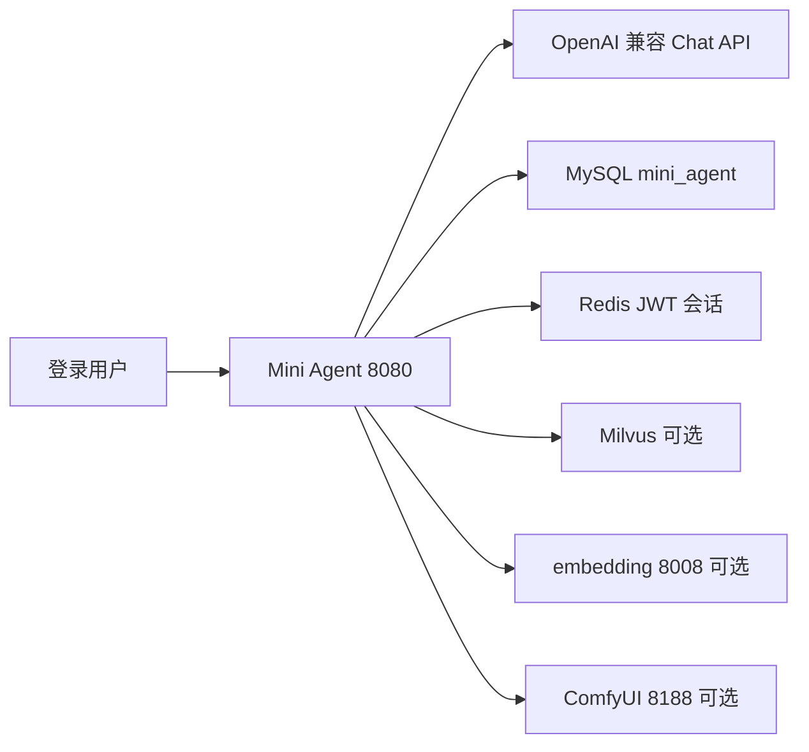
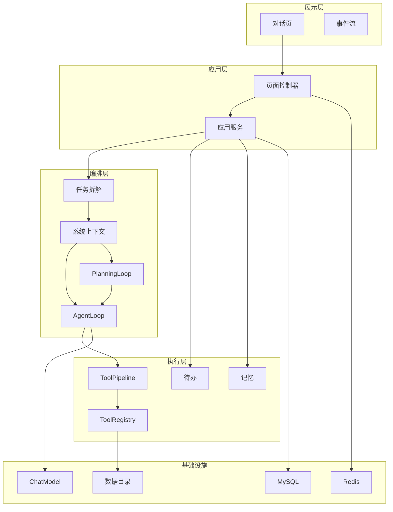
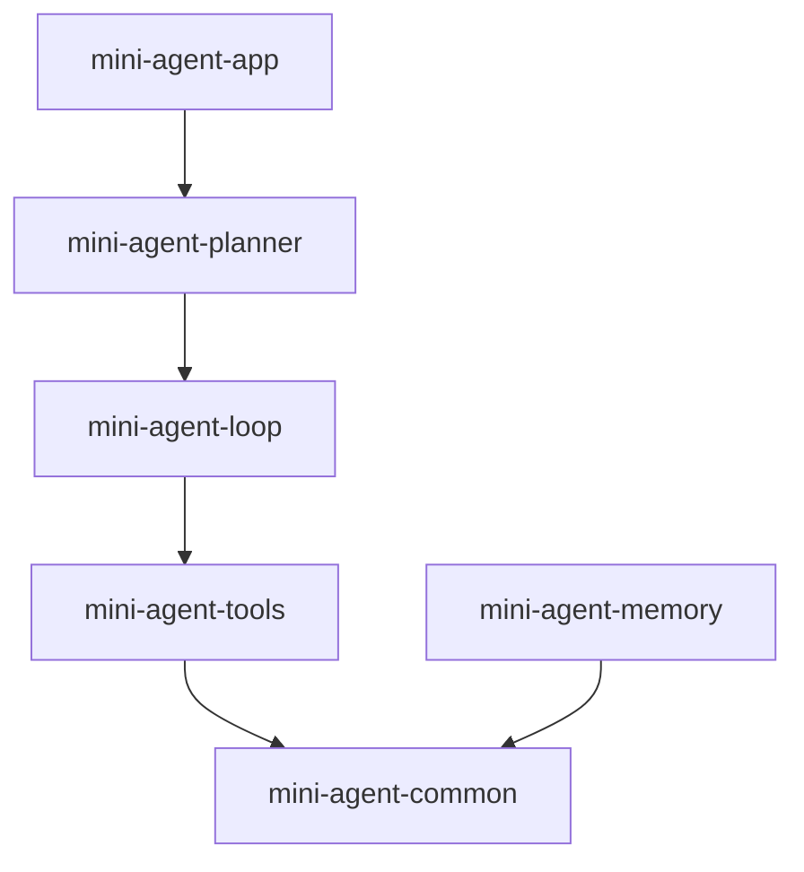
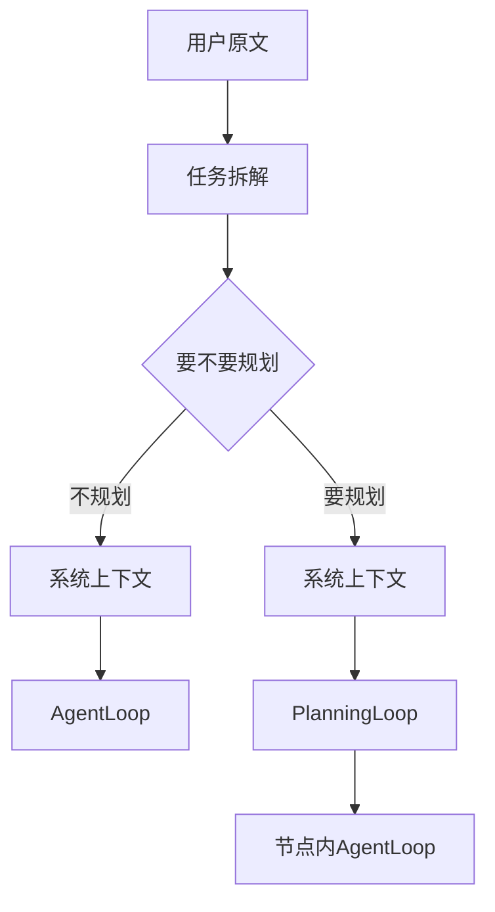
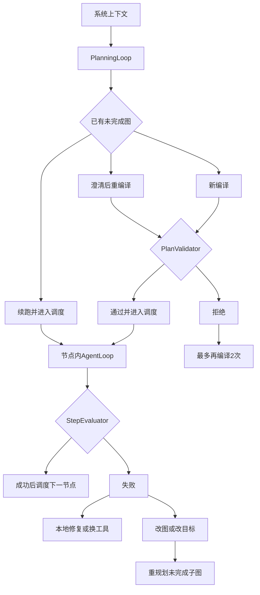
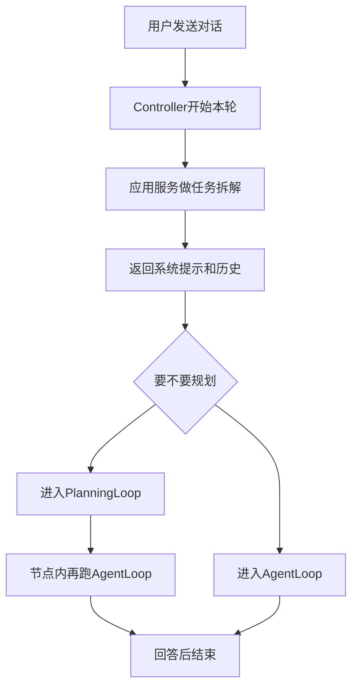
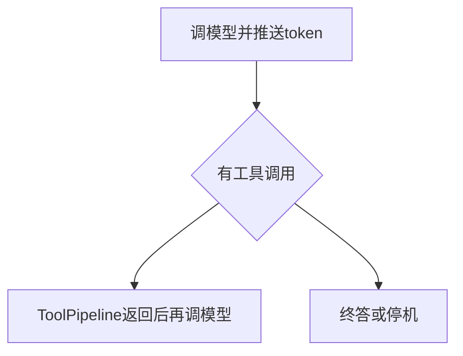
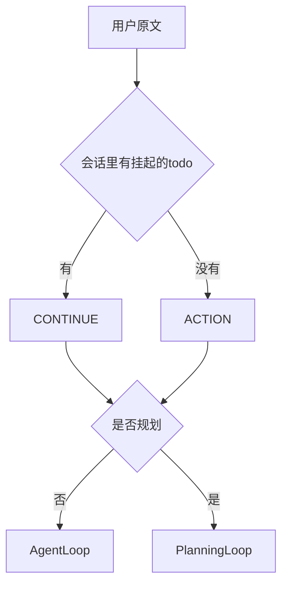

# Mini Agent · 详细设计文档

> **依据**：仓库当前源码与 `mini-agent-app/src/main/resources/application.yml`（默认 profile）。  
> **日期**：2026-09-22。  
> **原则**：只写已经实现的行为。未接线、已删除、配置写了但主路径不用的能力，放在第 13 章，不要当成已具备能力去实现。  
> **本文是唯一详细设计文档。** 初级工程师按第 14 章落地。类名、配置键、SSE 事件名以本文为准。

---

## 1. 文档说明

| 项目 | 内容 |
|------|------|
| **文档名称** | Mini Agent 详细设计（可按模块复现） |
| **版本号** | V2.0 |
| **状态** | 按代码反构，非愿景稿 |
| **代码根** | Maven 聚合工程 `mini-agent-springboot` |
| **Java / Spring / LC4j** | Java 21 / Spring Boot 3.4.5 / LangChain4j 1.15.0（根 `pom.xml`） |

**给初级工程师的读法**

1. 先看第 3.5 节的总图。不规划的轮次（含「你好」这种简单回答）**必须经过系统上下文**，再进入 `AgentLoop`。
2. 第 4 章是一轮 HTTP 对话的时序。第 5 章按模块写怎么实现。
3. 第 14 章是落地顺序。第 13 章是不要做的事。

---

## 2. 项目范围与功能点

### 2.1 系统是什么

Mini Agent 是 **单进程 Spring Boot Web 应用**：浏览器打开 `http://127.0.0.1:8080/`，登录后对话。服务端用 OpenAI 兼容 Chat Completions（默认 MiMo v2.5）驱动 **ReAct 循环**（`AgentLoop`）或 **任务图规划循环**（`PlanningLoop`）。两条路在调用模型之前都先装好系统上下文。工具走统一入口 `ToolPipeline`，过程通过 **SSE** 推到前端。

它不是：独立训练平台、多租户水平扩展集群（默认 `agent.replica.mode=local`）、也不是已删除的「意图分类」子系统。

### 2.2 用户角色（代码里真实存在）

| 角色 | 入口 | 能做什么 |
|------|------|----------|
| 未登录用户 | `GET /` → `login.html` | 登录；`agent.auth.registration-enabled=true` 时可注册 |
| 登录用户 | `chat.html` | 对话、上传、选模型、权限模式、待办确认、看自己的会话/轨迹 |
| `SYSTEM_ADMIN` | `/api/admin/*` | 租户/用户/审计接口已写；HTTP 层目前只要求已登录，见第 13 章 |

### 2.3 功能点清单（已实现）

| 编号 | 功能点 | 落点 |
|------|--------|------|
| F01 | 账号登录/注册/退出，JWT（Bearer 头）+ Redis 滑动 TTL | `JwtSessionService`、`POST /api/tokens` |
| F02 | 对话页：侧栏历史、设置、SSE 流式思考与正文 | `templates/chat.html`、`POST /api/conversations/{sessionId}/messages/stream` |
| F03 | 任务参数：目标原文 + 系统控制语识别，不做意图分类、不做词表匹配 | `TaskPlanFactory`、`TaskPlan` |
| F04 | 系统上下文：每一轮都装；按会话里有没有挂起的 todo 选 CONTINUE / ACTION | `ContextLoader`、`ContextLoadPolicy` |
| F05 | 直跑 Agent：ReAct，上限 `agent.execution.max-iterations`（默认 **90**） | `AgentLoop` |
| F06 | 规划 Agent：图为事实源，Todo 只是投影；节点内再跑 AgentLoop | `PlanningLoop`、`PlannerStateStore` |
| F07 | 子代理：`delegate_task`，内层上限 **25** | `DelegateTaskTool`、`subagent-max-iterations` |
| F08 | 统一工具管道：权限、确认、超时、死循环 | `ToolPipeline` |
| F09 | 内置工具：文件/命令/浏览器/搜索/生图/ComfyUI/技能/文档等 | `BuiltinTools` 及各 `*Tool` |
| F10 | MCP：可选，工具名 `mcp__{serverId}__{tool}` | `McpToolBridge`，默认 `agent.mcp.enabled=false` |
| F11 | 权限模式：default / plan / accept_edits / ask | `PermissionMode`、`PermissionPolicy` |
| F12 | 待办 `todo` 工具 + 前端任务条 | `TodoTool`、`TaskTodoStore`、SSE `todo` |
| F13 | 记忆：blob + 结构化；巩固异步 | `MemoryService`、`MemoryController` |
| F14 | 会话历史窗口 `agent.chat-memory.max-messages` 默认 **64** | `ChatMemoryConfig` |
| F15 | 轨迹落库 + `/trace` 页 + SSE `trace` | `TraceRecorder`、`agent_trace_steps` |
| F16 | 上传文件/图片/音视频（音视频源文件约 35MB） | `POST /api/conversations/{sessionId}/files`、`agent.multimodal.*` |
| F17 | 租户日 token 配额、并发任务上限 | `DbTenantTokenQuota`、`max-tasks-per-user=2` |
| F18 | 健康检查 `/actuator/health` 与 `/api/planner/health` | `HealthController` |

### 2.4 外部依赖

浏览器走 HTTP 与 SSE。Milvus、embedding、ComfyUI 默认可不启。



### 2.5 性能与预算（来自配置，不是 SLA 承诺）

| 指标 | 配置键 | 默认值 | 含义 |
|------|--------|--------|------|
| HTTP/SSE 超时 | `server.tomcat.connection-timeout` / `agent.sse.timeout-ms` | 1800000 ms | 长任务连接 |
| 直跑循环上限 | `agent.execution.max-iterations` | **90** | `AgentLoop` 封顶 |
| 子代理循环上限 | `agent.execution.subagent-max-iterations` | **25** | `delegate_task` 内层 |
| 规划节点一段 ReAct | `agent.planner.proposal-max-iterations` | **8** | 含 `browser_*` 时升到 16 |
| 同节点续跑段数 | `agent.planner.proposal-max-chunks` | **6** | 与 8 相乘为节点上限 |
| 规划外层轮次 | `agent.planner.max-outer-rounds` | **24** | 图调度圈数 |
| 单次工作窗口 | `agent.context.max-tokens` | 512000（估算 token） | 与模型声明的窗口取较小值：`ContextWindowResolver` 按 `context-window-tokens` / `supported-context-windows` / `max-input-tokens` 选出可用窗口（默认档优先，否则最小档），再减去工具 schema 开销（`toolCount × 170`） |
| 压缩触发 | `agent.context.pre-message-threshold` / `emergency-threshold` | 0.5 / 0.9 | 判据取 `max(TokenEstimator 估算, 最近一次真实 inputTokenCount − schema 开销)` ÷ 工作窗口。达到 0.5 触发；达到 0.9 时无视冷却与「连续无效」护栏 |
| 压缩后目标比 | `agent.context.engineering-sufficiency-ratio` | 0.15 | 工程压缩（结构化交接，纯字符串处理）后总量 ≤ 工作窗口 × 此值就不再调 LLM 摘要。0.15 与 WorkBuddy `getEngineeringCompactSufficiencyRatio()` 默认值一致 |
| ChatMemory 条数 | `agent.chat-memory.max-messages` | **64** | 滑动窗口条数 |
| 工具调用上限 | `agent.execution.max-tool-calls` | 120 | `ExecutionControl` |
| 累计 token 告警线 | `agent.execution.token-soft-limit` | 8000000 | 每轮 LLM 的 `input+output` **累加**（`ExecutionControl.afterModelTokens`）。**越线只写一条 `TOKEN_USAGE_WARN` 轨迹 + 一条 WARN 日志，不终止任务** —— 累计量随任务时长线性增长，与「是否失控」无因果关系，拿它做终止判据会误杀长任务 |
| 运行墙钟 | `agent.execution.deadline-ms` | 1800000 | 同上 |
| 每用户并发任务 | `agent.concurrency.max-tasks-per-user` | 2 | 超限拒绝新跑 |
| 接口限流 | `agent.rate-limit.per-minute` | 60（dev） | 按用户或 IP |
| 指代历史精捞条数 | `agent.context.history.question-with-ref` | **6** | 指代命中时按相关度取，替代不裁剪 |
| 出图重编译 | `PlannerProperties.maxReplanRetries` | **2**（Java 字段；yml 未写该键） | `PlanValidator` 拒绝后 |
| 运行时改图 | `agent.planner.max-rewrite-graph` | **2** | `REWRITE_GRAPH` |
| 改目标 | `agent.planner.max-revise-goal` | **1** | `REVISE_GOAL` |
| 规划总恢复 | `agent.planner.max-recoveries` | **3** | 达限则节点 CANCELLED |

这些是引擎预算。仓库里没有单独的 QPS 合同。

---

## 3. 总体架构

### 3.1 架构模式（已选定）

**模块化单体（Maven 多模块 + 一个可运行 app）**。同一进程内循环、工具、SSE 共享会话。

编排是双内核，**两个内核的入参都包含系统上下文**：

| 内核 | 类 | 何时进 | 进之前必须有 |
|------|-----|--------|----------------|
| ReAct | `AgentLoop` | `shouldHandle` 为 false，含简单问答 | `systemPrompt` + `history` + `TaskPlan.toPromptBlock` |
| 任务图 | `PlanningLoop` | `shouldHandle` 为 true | 同一份 `systemPrompt` + `history`；节点内再交给 `AgentLoop` |

`delegate_task` 不是第三套顶层路由。它是工具，内部再 new 一轮 `AgentLoop`（上限 25），同样传入系统提示。

### 3.2 分层



`AgentLoop` 没有从任务拆解直连过来的边。系统上下文是它唯一的上游。

| 层次 | 技术 | 职责 |
|------|------|------|
| 展示 | Thymeleaf + 内联 JS/CSS | 对话、设置、任务条、流式渲染 |
| 应用 | Spring MVC | 鉴权、会话、流式桥接、上传 |
| 编排 | loop + planner | 信号 → **系统上下文** → 选内核 → 停机策略 |
| 执行 | tools | 唯一工具入口、权限、副作用 |
| 基础 | MySQL / Redis / 本地盘 / 外部 LLM | 持久化与模型 |

层间协议：浏览器 ↔ 应用为 HTTP + SSE；编排 ↔ LLM 为 LangChain4j；工具为进程内方法调用。

### 3.3 Maven 模块依赖（必须无环）

箭头只画相邻层，这是编译落地顺序。跳层依赖也存在，例如 app 直接依赖 common，planner 直接依赖 tools。那些线画出来会叠在一起，完整列表见上面的模块表。



| 模块 | 职责（一句话） |
|------|----------------|
| `mini-agent-common` | `ApiResponse`、`ErrorCode`、`MessageConstants`、共享 embedding/Milvus 客户端 |
| `mini-agent-memory` | `MemoryStore` / `MemoryService` 接口及记忆领域模型；owner 上下文与通用数据目录位于 `mini-agent-common` |
| `mini-agent-tools` | `ToolRegistry`、内置工具、MCP、浏览器、ComfyUI |
| `mini-agent-loop` | `AgentLoop`、系统上下文、权限、Todo、轨迹、`delegate_task` |
| `mini-agent-planner` | `PlanningLoop`、图编译/调度/评估 |
| `mini-agent-app` | 可运行 JAR：Controller、Security、Thymeleaf、装配 Bean |

**落地顺序**：common → memory → tools → loop → planner → app。

### 3.4 两套「模块」不要混

| 视角 | 是什么 | 用来干什么 |
|------|--------|------------|
| 编译期 | Maven：common → memory → tools → loop → planner → app | 依赖必须无环 |
| 运行时 | 拆解 / 系统上下文 / 规划 / 执行 / 工具 / 记忆 / 闭环 | 一轮对话里的调用关系 |

`mini-agent-loop` 同时装了拆解、上下文、执行、部分闭环。实现时按运行时边界拆类。

### 3.5 云端记忆服务解耦边界（阶段一）

`mini-agent-memory` 不是可执行 Spring Boot 服务，而是被执行端和记忆实现共同依赖的跨进程契约模块。阶段一先把最容易形成一致性闭环的 Procedure 节点终态结算切成窄端口：

| 契约 | 作用 | 禁止依赖 |
|------|------|----------|
| `MemoryPrincipal` | 传递已经由调用方认证的 `tenantId/userId/projectId/sessionId` | 不接受请求体伪造身份替代服务端认证 |
| `ProcedureSettlementCommand` | 携带执行时绑定的 `procedureId/procedureVersion`、任务/节点幂等键和 SUCCESS/FAILURE | 不按服务端当前版本猜测结算版本 |
| `ProcedureSettlementPort` | 结算一次 Procedure 应用事实，返回 `RECORDED/DUPLICATE/STALE_PROCEDURE/SKIPPED` | 不暴露 JPA Entity、Repository、Spring 类型 |

当前运行时结构是：

```text
PlanningLoop
  -> NodeTerminalCommitPort
  -> ProcedureNodeTerminalCommitAdapter
  -> ProcedureSettlementPort
  -> ProcedureApplicationSettlementService
  -> agent_procedure_applications + agent_procedures
```

`ProcedureNodeTerminalCommitAdapter` 只负责把 Planner 的 `TaskNode` 和 `OwnerContext` 转成 `ProcedureSettlementCommand`；`ProcedureApplicationSettlementService` 只实现 `ProcedureSettlementPort`，保留原有 `REQUIRES_NEW` 幂等事实写入、唯一键并发裁决、版本条件更新和治理失败隔离。这样未来服务器部署可以把 `ProcedureSettlementPort` 替换为带服务间认证的远程适配器，云端记忆服务也不需要依赖 `mini-agent-planner`。

本阶段尚未声称远程 HTTP 服务已经完成：尚未新增独立的 `mini-agent-memory-service` Spring Boot 进程、内部认证过滤器、HTTP DTO/controller、重试与 outbox 投递。桌面档继续使用同进程本地实现；服务器档在远程适配器完成前仍使用 `mini-agent-app` 内的本地实现。下一阶段应先定义 HTTP DTO 与服务间认证，再决定同步结算是否改为可靠事件加幂等消费者，不能把同步网络失败直接变成已完成节点失败。

### 3.6 运行时总图（一轮用户消息）

这张图是实现时的主路径。**不规划的出口不能连到 `AgentLoop`。** 它先进入系统上下文，系统上下文再进入循环。简单回答走的就是左边这条。



左右两个「系统上下文」是同一次 `ContextLoader.load` 的结果，不是两套装配器。源码把 `load` 写在 `shouldHandle` 之前，调用一次，然后把 `systemPrompt` 和 `history` 传进选中的内核。图上把它画在分叉的两条出边上，是为了禁止画成「不规划 → 直接进 Loop」。

`AgentLoop.run` 组给模型的消息顺序（`AgentLoop` 约 355–366 行）固定为：

1. `SystemMessage(systemPrompt)`：`ContextBuilder` 拼出的系统上下文。空白则不放。
2. `SystemMessage(taskPlan.toPromptBlock)`：本轮任务约束（`taskGoal` + `allowedTools` + 一句执行方式）。
3. `history`：`ContextLoader` 裁好的对话历史。
4. `UserMessage`：本轮用户原文。

每一轮都带这份系统上下文，不存在「这一轮是简单问答所以跳过」的分支。区分「短问题」与「动手任务」不再由代码做：`AgentLoop` 里没有按文本预分类的注入分支。

#### 3.5.1 每一轮的系统上下文里有什么

| 槽位 | Order | 新任务（ACTION） | 续跑（CONTINUE） |
|------|-------|------------------|------------------|
| IDENTITY | 10 | 有。`PromptTemplates.identity()` | 有 |
| AUTHORITY | 20 | 有 | 有 |
| REFERENCE | 30 | 仅当指代检测要求带回历史 | 同左 |
| MEMORY | 40 | 有（`injectMemory=true`） | 有 |
| SKILLS | 50 | 有 | 有 |
| REASONING | 60 | 有 | 有 |
| TOOLS | 70 | 槽位为空。工具说明在 `AgentLoop.bindTurnTools`，不在 Builder 里 | 同左 |
| TODO | 80 | 挂起上一任务后按当前清单渲染 | 先恢复挂起清单再渲染 |
| CLOSING | 90 | 有，含当前时间 | 有 |

槽位表里没有 QUESTION。它原来只在「轻问答」时塞 `PromptTemplates.QUESTION_MODE`；判据删除后它恒为空，已一并去掉。

历史条数：非指代不裁剪（`-1`），指代命中改为 `agent.context.history.question-with-ref`（默认 **6**）条相关度精捞。两档策略的 `userMaxChars` 都是 0（不限），不再有「短问答只带 200 字用户摘要」这一档。

#### 3.5.2 要规划时，系统上下文之后才进图

`PlanningLoop.run` 的参数同样包含这份 `systemPrompt` 和 `history`。节点执行再调用 `AgentLoop`，不是另起一份空系统提示。

规划器内部（只有 `shouldHandle == true` 才存在）：

回到调度的回路写在节点文字里，不再画回边，避免标注叠在线上。



| 时机 | 方法 | 上限 | 改什么 |
|------|------|------|--------|
| 调度前，`PlanValidator` 拒绝初图 | `compileAndValidate` → `compileWithCorrection` | `maxReplanRetries` 默认 **2**（Java 字段，yml 未写） | 整张新图 |
| 节点失败且分类为改图或改目标 | `tryLlmReplan` → `mergeKeepSuccess` | 改图 2、改目标 1，并受 `max-recoveries=3` 约束 | 未完成子图，已 SUCCESS 节点保留 |

`LOCAL_REPAIR` / `REPLACE_TOOL` 把失败节点置回 `PENDING`（换工具时记下 blocked tool），回到同一张图的调度，不调用 LLM 重编译。直跑没有图，因此没有恢复分类。没有「重新规划」按钮。

直跑的任务清单由模型调用 `todo`，停机前 `TodoPlanStopHook` 检查。规划路径的清单由 `TodoStateProjector` 从图覆盖投影，完成只认 `StepEvaluator`。

#### 3.5.3 实现 `doExecuteAgent` 的顺序

```text
taskPlan = taskPlanFactory.build(userMessage)
loaded   = contextLoader.load(...)          // 简单问答也执行
system   = loaded.systemPrompt()
history  = textOnlyHistory(loaded.history())
if planningLoop.shouldHandle(taskPlan, sessionId, userMessage):
    answer = planningLoop.run(chat, system, ..., history, ...)
else if hasMedia:
    answer = agentLoop.runWithMultimodal(chat, system, ..., history, ...)
else:
    answer = agentLoop.run(chat, system, userMessage, history, ...)
memory.add(user); memory.add(assistant)
persistTurn(...)
async consolidate    // 线程内 bindOwnerContext + 绑定用户模型
```

禁止写成：

```text
if 不需要规划:
    agentLoop.run(userMessage)    // 丢掉系统上下文
```

`shouldHandle` 为 false：`agent.planner.enabled=false`，或 `plan == null`。为 true：`DecompositionPolicy.hasGraphSignal`（原文或 taskGoal 里能抽出路径或 URL）。否则仅当该 scope 有未完成图且 `PlannerResumePolicy.shouldResume` 为真。

### 3.6 模块间契约

| 从 → 到 | 契约 |
|---------|------|
| 拆解 → 系统上下文 | 每一轮都 `load`。挂起状态决定 CONTINUE / ACTION |
| 系统上下文 → AgentLoop | `systemPrompt` + `history`。简单问答走这条，不走规划器 |
| 系统上下文 → PlanningLoop | 同一份 `systemPrompt` + `history` |
| PlanningLoop → AgentLoop | 节点内再跑循环，上限 8 或浏览器 16，最多 6 段，不是 90 |
| 执行 → 工具 | 只 `ToolPipeline.invoke(ToolRequest)` |
| 规划 → 验收 | 节点证据给 `StepEvaluator`；失败才 `RecoveryEngine` |
| 规划 → 闭环 | `TodoStateProjector` 覆盖写出，禁止 Todo 写回图 |
| 直跑 → 闭环 | 模型 `todo` + `TodoPlanStopHook`。没有 `RecoveryEngine` |
| 记忆 → 系统上下文 | 只 `retrieveForPrompt(policy)`。LIGHT 默认不注入长期记忆 |
| 回合结束 → 记忆 | 异步 `consolidate`，不堵在 SSE `end` 之前 |

---

## 4. 核心业务流

### 4.1 一次对话（主路径）

用流程图代替时序图。时序图参与者一多，报文会压在生命线上。



简单问答走「不规划」。系统提示在进入内核之前已经返回。

循环内部：



空消息在 Controller 返回 `CHAT.01.01`。同会话已在跑返回 `CHAT.03.01`。

**停机条件（AgentLoop）**：纯文本终答；`MAX_ITERATIONS`；`DUP_TOOLS`（同失败工具 ≥3）；`OUTCOME_UNKNOWN`；`CANCELLED`；`DEADLINE_EXCEEDED`；`PERM_ASK`；`USER_QUESTION`；资源或配额耗尽。

### 4.2 进不进规划器，与上下文装多少，是两件事

这两件事都发生，互不代替。

- **装多少**：只看一个运行时事实 —— 这个会话里有没有被挂起的 todo 清单（`ContextLoadPolicy.forSuspendedTodo(boolean)`）。有 → `CONTINUE`（恢复清单），没有 → `ACTION`（挂起上一任务的活动清单）。不再根据用户原文命中哪些词来决定。
- **进哪个内核**：`PlanningLoop.shouldHandle`（`agent.planner.enabled=false` 或 `plan == null` 时直接 false），再看 `DecompositionPolicy.hasGraphSignal`（原文或 taskGoal 里能抽出路径或 URL），否则仅当该 scope 有未完成图且 `PlannerResumePolicy.shouldResume` 为真。

一步就能做完的请求：上下文用 `ACTION`（记忆、技能、todo 全开），内核仍是 `AgentLoop`。



进不进规划器只由 `shouldHandle` 决定，那里没有「这轮要不要结构化计划」这一档：要么原文/taskGoal 里能抽出路径或 URL（`DecompositionPolicy.hasGraphSignal`），要么该 scope 有未完成图且 `PlannerResumePolicy.shouldResume` 为真。

### 4.3 工具调用

所有工具走 `ToolPipeline`，顺序不能调换：

`ToolRequest` → 名为空则失败 → `ExecutionControl.beforeTool` → 执行围栏 → 探测拒绝 → 规划硬闸 `LoopTurnPolicy.denyTool` → Plan 模式未批准则非安全工具拒绝 → `ask_user_question` 则 SSE `user_question` → 需要 grant 且未授权则 SSE `permission_ask` → `ToolHookChain` → `ActionJournal` + 超时/并发 → `ToolRegistry` 执行 → after hook → `ToolInvocation`。

新工具：`@Component`，`@PostConstruct` 里 `registry.register`。不要在 `AgentLoop` 里按工具名分支调用文件系统。

### 4.4 权限模式

| 模式 | 行为 |
|------|------|
| default | `ChatRequest.permissionMode` 缺省。`agent.tools.exec-enabled=true` 时 `exec_command` 免批；`http_post` 仍要 grant |
| plan | 未批准时规格只留 `PLAN_SAFE_TOOLS` |
| ask | 危险工具仍出现在规格里，执行时拦截并推 `permission_ask` |
| accept_edits | `needsSessionGrant` 恒 false，待办确认可跳过 |

生产 profile 把 `exec-enabled` 设为 false。改模式：`PUT /api/conversations/{sessionId}/permission`。

---

## 5. 功能模块详细设计

内核模块按这个骨架写：边界 → 类型 → 流程 → 配置 → 实现清单 → 禁止。

| 节 | 模块 |
|----|------|
| 5.1 | 认证与会话 |
| 5.2 | 对话应用服务 |
| 5.3 | 任务拆解 |
| 5.4 | 系统上下文 |
| 5.5 | 工具 |
| 5.6 | 记忆 |
| 5.7 | 规划 |
| 5.8 | 执行 |
| 5.9 | 任务闭环 |
| 5.10 | 前端与轨迹 |

### 5.1 认证与会话

> **无状态改造（已落地）**：凭证只走 `Authorization: Bearer`，服务端不写任何 cookie。
> 前端把 JWT 存 `sessionStorage`（键 `ma_token`），由 `static/js/security.js` 统一注入请求头，
> 收到 401 即清 token 并 `location.replace('/login')`。
>
> 代价要写清楚：`sessionStorage` 对 XSS 可读，而 httpOnly cookie 不可读 ——
> 这是把「防 XSS 窃取」换成了「防 CSRF」，不是单纯的增强。

1. `POST /api/tokens`：校验用户 → `JwtSessionService.issueToken(userId)` 返回 JWT 明文（**不写 cookie**），
   Redis 键 `session:jwt:{jti}` → userId，TTL = `agent.auth.jwt-ttl-seconds`（默认 **1800**）。
   JWT `exp` 上限 `jwt-exp-seconds`（默认 7 天），与 Redis 并存时 `exp` 只是硬上限。
2. `SignedSessionFilter` 只认 `Authorization: Bearer`。命中 Redis 则放行并写入
   `authUserId` / `authPrincipal` request attribute；未命中且路径不在 `SecurityConfig.PUBLIC_PATHS`
   白名单里，**filter 直接返回 401 JSON**，不放行到 MVC。
3. 每次鉴权刷新 Redis TTL（滑动窗口，空闲 30 分钟即失效）。
4. `DELETE /api/tokens`：删 Redis 键 + 摘掉该用户的 SSE 流，返回 `ApiResponse`；
   清 `sessionStorage` 与跳转移交前端（服务端没有任何「浏览器自动清除」的环节可依赖）。
5. CSRF 防护**整体关闭**。CSRF 的前提是「浏览器自动携带凭证」，而 Bearer 头只能由页面脚本显式添加，
   跨站请求无法自动附带；再叠一层 `XSRF-TOKEN` 只会制造 403。

**会话 id 由服务端签发**：`POST /api/conversations` 生成 `s_<uuid32>` 并立刻
`conversationStore.claim(userId, sessionId, null)` —— id 与 `user_id` 同时落库，
此后所有会话作用域接口都能用严格判等（`SessionAuthorizationService.owns`）拒绝他人。
客户端不再自造 id：自造意味着归属记录只能等首条消息落库才出现，中间那段只能靠
「这个 id 被别人占了吗」猜，那就是越权口子。

页面入口 `GET /`、`GET /login`、`GET /trace` 一律放行骨架并返回同一套 HTML：浏览器导航请求
带不了自定义头，服务端拿不到身份，分流只能由前端读 `sessionStorage` 后自己决定。

dev 默认 `registration-enabled=true`，`password-min-length=8`（yml 覆盖 `AuthService` 字段缺省 12）。
生产关闭注册。JWT 签名密钥为 `agent.auth.jwt-secret`（env `JWT_SECRET`，旧名 `COOKIE_SECRET` 仍可回退）。

不要把 `auth_sessions` 表当成在线会话真相源。活会话在 Redis。admin `revoke-sessions` 写的是 DB 行，不会立刻踢掉 Redis JWT。

### 5.2 对话应用服务

类：`AgentChatApplicationService`。`doExecuteAgent` 顺序见 3.5.3，不要把 `shouldHandle` 放到 `load` 前面，也不要在 false 分支里省略 `system` 和 `history`。

并发：`taskRunService.tryStart`。每用户同时任务数 `agent.concurrency.max-tasks-per-user=2`。

媒体：`hasMedia` 只决定用 `resolveForMultimodal`（预设 `agent.multimodal.vision-preset` 默认 `default`）以及是否拼点评轮提示。它不决定历史条数，也不代替系统上下文。历史经 `ChatMessageTexts.textOnlyHistory`，避免旧的 `image_url` 把文本模型打成 400。

### 5.3 任务参数

**做：** 原文 trim → `TaskPlan(taskGoal, allowedTools, steps, reason)`。`TaskPlanFactory.build` 只区分一件事：这条消息是不是前端拼的系统控制语（`MessageConstants.isSystemControlMessage`），结果写进 `reason`（`system-control` / `user-message`）。`allowedTools` 恒为 `null`（不限制），`steps` 恒为空。

**不做：** 从用户原文抽「命中信号」，也不判断「这轮要不要结构化计划」。图节点来自 `GoalCompiler`，`TaskPlan` 不产图。

| 字段 | 含义 |
|------|------|
| `taskGoal` | 用户原文（trim 后），作为本轮目标锚 |
| `allowedTools` | `null` = 全量工具面；子代理会传具体清单 |
| `steps` | 恒为空。图节点不从这里来 |
| `reason` | `system-control` / `user-message` / `subagent:*` |

**2026-10-22 删除记录。** 这里原来有一层「任务信号」：`TaskSignals`（14 个布尔）+ `TaskSignalProperties`（`agent.task-signals.rules` 下 9 张词表 + `question-max-len` + `force-full-on-image-into-doc`）+ `TaskSignalMatcher`（把词表编译成正则，另带一批硬编码动词/扩展名正则）。它派生两个值：

| 原派生值 | 原来影响 | 现在的判据 |
|---------|---------|-----------|
| `requiresStructuredPlan` | 目标锚定是否注入；`closeRetrieval` 是否豁免；空终答能否直接返回；`TodoPlanStopHook` 是否先要求 `todo.set` | 目标锚定每轮注入一次；检索闸门只按次数；收尾只按有没有未完成清单 |
| `lightTurn` | 跳过子目标刷新；收尾不卡 todo；`TodoPlanStopHook` 直接放行；历史条数改小 | 一并删除，统一走 ACTION 策略 |

连带的确定行为变化（不是 bug）：

1. 短问答也注入长期记忆与技能表。以前走 `LIGHT`（`injectMemory=false`），现在没有「短问答」这个判据，只能统一按 `ACTION`。
2. 检索工具到 `RETRIEVAL_CALL_CAP`（**8** 次）即关闭，不再对任何任务豁免。关闭时移除 `web_search`/`web_extract`/`http_get`/`http_post`/`browser_*` 并注入【检索已够】。
3. 空终答只在「有未完成 todo 清单」时继续拦；不再因为「这轮被判为结构化任务」而拦。

`DecompositionPolicy.hasGraphSignal`：原文或 taskGoal 里能抽出路径或 URL 即为真。短「下载这个链接存盘」仍可进规划器。

模板（`GoalCompiler.templateGraph`）：diagram、fetchWrite、readThenAnalyze、researchThenFile，否则单节点或澄清图。`structureDeterminate` 为假且需要结构化时才 LLM 编译，`compiler-retry` 默认 1。

| 键 | 默认 |
|----|------|
| `agent.planner.compiler-retry` | 1 |
| `agent.planner.planner-timeout-seconds` | 60（Java 字段） |

禁止：恢复按用户原文做分类或词表匹配；让 Factory 生成假的 `TaskStep` 冒充图；把「这轮属于哪一类」重新塞回 `TaskPlan`。

### 5.4 系统上下文

**做：** 本轮 system 字符串、历史切片、todo 挂起/恢复、任务 scopeKey。  
**不做：** 调工具、编译图、把工具 JSON schema 写进 `ContextBuilder`。

`ContextLoader.load` 步骤：

1. `ContextReference.detect(query)`；`taskTodoStore.hasSuspended(sessionId)` 得出本轮策略。
2. `ContextLoadPolicy.forSuspendedTodo(hasSuspendedTodo)`：有挂起清单 → CONTINUE，没有 → ACTION。没有 LIGHT 档。
3. 指代命中时把历史上限改成 `agent.context.history.question-with-ref`（默认 6）并打开记忆注入；未命中保持不裁剪（`-1`）。
4. 正在 `awaiting_confirm`：不挂起、不恢复。否则 CONTINUE 恢复挂起清单，ACTION 挂起活动清单。
5. `TaskScopeRegistry.scopeKey`：`taskId==0` 用 `sessionId`，否则
   `sessionId#taskId`。`current_task_id`、`paused_task_id`、`scope_sequence`
   存在 `agent_session_todos`，用该行 `version` 做 CAS；未装配持久化端口的纯单测
   才回退进程内 Map。规划图和压缩摘要按 scopeKey。对话历史整段保留，
   不按任务边界截断。
6. `selectHistory`：非指代按条数从尾切，`-1` 不裁。指代走 `ContextHistorySelector`（向量 `ref-min-score=0.35`，失败回退词重叠下限 0.15，扫描池 `ref-scan-max=48`）。
7. `ContextBuilder.build` → `LoadedContext`。

ACTION：`suspendActiveTodo=true`。清单未完成则挂起；全是 completed/cancelled 则归档清空。等确认时跳过挂起。

预算：`agent.context.budget.enabled=true`，`chars-per-token=2.0`。槽 token 默认：identity 2000、authority 400、reference 300、memory 6000、skills 2000、reasoning 1500、tools 4000、todo 2000、closing 1500。超窗：`max-tokens=512000`，触发阈值 0.5 / 紧急 0.9。压缩保留「前置 system + 首条用户意图」与**当前轮**（最近一条用户消息之后的工具往返），其余历史折叠为一条交接摘要；`llm-summary-enabled=false` 时只做工程压缩。

槽位表里没有 QUESTION。它原来只在轻问答时塞 `PromptTemplates.QUESTION_MODE`，判据删除后就成了一个恒空的槽，一并去掉；`agent.context.budget.slot-tokens.question` 也不再读。

`injectMidterm` 两套策略都是 false，`updateMidtermMemory` 主路径无调用方，因此 MIDTERM 不属于当前运行时注入或写入链路。`MemoryStore` 仍读取旧 `MIDTERM.md`，DB blob 仍保留 `midterm`，冷启动 DB 为空时会把旧文件导入 DB；这些读入路径是历史数据兼容，不得与运行时功能混为一谈。保留兼容字段与导入逻辑，不要把开关打开成中期记忆注入；待明确迁移窗口和存量数据处置策略后，再单独移除兼容读路径。

Todo 存储键仍是 sessionId，靠挂起字段隔离，不是 `#` 键。

禁止：用 system 边界标记截断历史；问答轮 `historyMaxMessages=0`；在 Builder 里塞工具 schema；不规划的分支跳过 `load`。

### 5.5 工具

**做：** 注册、规格、权限、超时、并发、执行、`ToolResult`。  
**不做：** 决定本轮工具面（`ToolSurface` + `PermissionPolicy`）；不给每个工具开 REST。

`ToolRegistry.register` 按名 `putIfAbsent`，重名抛 `IllegalStateException`。

内置名在 `BuiltinTools`：文件、`http_get/post`、`web_search/extract`、`search_code`、`edit_file`、`exec_command`、`browser_*`、`image_generate`、`comfyui_*`、`skill_*`。其它 `@PostConstruct`：`memory`、`todo`、`ask_user_question`、`delegate_task`、`codebase_search`、`ast_search`、`write_document`、`write_docx`、`write_xlsx`、`edit_document`、`render_diagram`、`agent_environment`。MCP 默认关闭，名 `mcp__{serverId}__{tool}`。

| 类型 | 取值 |
|------|------|
| `ToolStatus` | SUCCESS / FAILED / TIMEOUT / CANCELLED / AWAITING_USER / UNKNOWN |
| `ToolInvocation.Outcome` | EXECUTED / GATE_DENIED / POLICY_DENIED / PERMISSION_ASK / USER_QUESTION / CONTROL_STOP / FENCE_REJECTED |

| 项 | 值 |
|----|-----|
| 全局并发 | `agent.tools.max-concurrency=8` |
| 未知工具默认超时 | 60s |
| `exec_command` 外层闸 | 内层默认 120s、上限 600s；外层 = 声明值 + 15s，未声明为 **135s** |
| 规划节点额外封顶 | `agent.planner.action-timeout-seconds=0` 表示不额外砍 |

`AgentLoop` 里那张工具超时常量表是死表。真正超时走 `ToolExecutionGuards` → `ToolConcurrencyPolicy`。

技能目录：`{agent.data-dir}/skills`，默认 `{user.home}/.miniagent/skills`。`agent.data-dir` = `MINI_AGENT_HOME` 或 `~/.miniagent`。`allow-absolute-write=false`，`block-private-network=true`。

### 5.6 记忆

| 门面 | 给谁用 | 方法 |
|------|--------|------|
| `MemoryService` | 系统上下文 + `memory` 工具 | `retrieveForPrompt`、`add/replace/remove/read` |
| `MemoryManager` | 巩固 + `/v1/memory` | 事件、条目、工作记忆、事实/SOP/episode、`consolidate` |

对话路径只调 `retrieveForPrompt`。任务起止通过 `recordEvent` 写入 `AgentEvent`；工具执行由 `MemoryToolExecutionSink` 写入 `TOOL_EXECUTION`。结束后异步 `consolidate`（线程内绑定 owner 与用户模型）。

`memory` 工具：action = add / replace / remove / read；target = `memory` 或 `user`。用户画像走语义事实，不要只追加 blob。

`MemoryReadPolicy` 由 `ContextLoadPolicy.memoryPolicy()` 映射：working←`injectTodo`，longTerm←`injectMemory`，user←`injectUser`。policy 全关返回空字符串。

写入：`AgentEvent` → 分类 → 重要度 → 闸门（`agent.memory.importance-threshold` 默认 0.3；短于 8 字、套话、安全扫描丢弃）→ 去重 → 表。分类：用户反馈→USER；工具/任务/错误→EPISODIC；计划变更/事实→SEMANTIC；可复用步骤→PROCEDURAL。

**本轮任务级记忆契约（阶段一）**：事件的 `sessionId` 是会话归属，`taskId` 是该会话内 `TaskScopeRegistry` 发出的十进制任务序号，不能把 `sessionId#taskId` 的 `scopeKey` 当作 `taskId`。`TASK_START`、`TASK_COMPLETE`、`TASK_FAIL` 与 `TOOL_EXECUTION` 必须使用同一轮执行捕获的任务序号；一次执行期间不得在事件生产者处重新解析当前作用域。`taskId=0` 表示初始任务且合法。`TaskScopeRegistry` 当前负责任务状态隔离，但不构成持久化任务谱系；阶段一不生成 `CONTINUES`、`CONTRADICTS` 边，也不声称有跨任务经历簇。

**检索契约（阶段一）**：只返回 `ACTIVE` 记忆。`VERIFIED` 是巩固/审核状态，不代表可检索发布；将来若开放检索必须单独定义发布转换。每个候选在进入混合排序前都必须匹配完整 `MemoryScope`（`tenantId + scopeType + scopeId`），无论来自 keyword 还是 vector。评分中的 `scopeRelevance` 不是授权过滤。Controller 必须以认证主体 tenant 为准；显式不匹配的 tenant 请求拒绝，不静默改写。

**租户键契约**：记忆主键可继续使用全局生成的数值 ID；所有业务查找、更新、删除与关联查询仍必须同时约束 `tenantId`。新增唯一约束不得只含 `memoryId` 以外的租户业务字段；应将 `tenant_id` 纳入复合唯一键。现有全局 ID 不等于授权凭证。

工作记忆：MySQL `agent_working_memories` + Redis `wm:{sessionId}`，TTL `agent.replica.memory-ttl-seconds` 默认 86400。向量：`agent.memory.vector.enabled=true`，`backend=local` 或 `milvus`（维度 1792）。

**Procedure 应用闭环（已实现）**：作用域固定为 **USER**（`tenant_id + userId`），不用 PROJECT —— 对话执行只有 `OwnerContext(userId, tenantId)`，没有可信的 `projectId`，而 `MemoryController` 也只授权 USER/SESSION。

**SOP 身份与版本（写入侧契约）**：identity 是 `(tenant_id, scope_type, scope_id, trim + lowercase 后的 name)`，`procedure_version` 是这一行的属性，**不是** identity 的一部分。`ux_ap_identity`（tenant_id, scope_type, scope_id, name）在库层面禁止同名两行 —— 桌面档由 `ddl-auto: update` 从 `AgentProcedureEntity` 的注解建，prod 档 `ddl-auto: validate` 不校验唯一键、由 V13 迁移建，两处必须同名同列。`ProcedureUpsertService` 是唯一写入点：

- 内容（description + preconditions + steps + successConditions）与库里一致 → 幂等写，不升版、不动计数。
- 内容变了 → 原地升版：**同 id**、`procedure_version + 1`、`success_count`/`attempt_count`/`success_rate`/`usage_count` 全部清零。id 不变是因为已经发出去、指向这条 SOP 的节点引用必须继续解析到它；计数清零是因为这些计数描述的是「**这一版内容**被用过几次、成了几次」，v1 的成绩不属于 v2。旧版本的证据按 `procedure_version` 留在 `agent_procedure_applications` 里，没丢。
- `importance` 与名称拼写只走元数据更新：重要度是排序权重，不是 SOP 内容，改它不该清掉这一版的成功率。
- 同名的 `ARCHIVED` 行被**复用**并升版复活，不新建行 —— 唯一身份不允许同名两行。
- 并发：首次写入靠唯一键裁决（插入放在 `REQUIRES_NEW` 独立事务里，撞键只回滚内层），已有行靠 `procedure_version` 做 CAS，最多重试 3 次；每次重试前重读并重新判断内容，重试用尽报 `MEMORY_WRITE_FAILED`，不静默丢写入。
- V13 迁移负责存量：先按同一套归一化规则把同名重复行改名成 `<原名> #archived-<id>` 并置 `ARCHIVED`，再建唯一索引。**不把被合并行的计数累加到保留行** —— 应用事实仍按原 `procedure_id` 记账，把计数搬过去会让「统计可由事实重算」这条不变量失效。

链路如下：

1. `DefaultMemoryManager.findForCurrentOwner` 按 USER scope 查 `ACTIVE` Procedure，转成 `ProcedurePromptInput`（id、version、名称、前置条件、步骤、成功条件）；`GoalCompiler` 经 `ProcedurePromptPort` 把候选注入规划提示，模型在节点上声明 `procedureId` / `procedureVersion`。写入侧由 `ProcedureUpsertService` 保证同一身份的 `ACTIVE` 行唯一，所以候选里不会出现同名两行。
2. `GoalCompiler.parseGraph` **只接受本轮候选里存在的 id+version**：非法或缺失的声明直接丢弃，节点退化为不挂 Procedure。不猜、不补、不按名称模糊匹配。
3. `TaskNode` 保存 `procedureId/procedureVersion`，所有 `with*` 变换都保留引用。`PlannerStateStore.sameGraphSemantics` 目前**不**比较这两个字段 —— 它们是绑定元数据，变化不应触发 planVersion 冲突。
4. 节点终态由 `PlanningLoop.settleNode` 上报 `NodeTerminalCommitPort`，只在 `NODE_SUCCESS` / `NODE_FAILED` 和图终验失败处调用。`TOOL_EXECUTION` 的成败**不参与**结算：工具成功不等于节点验收成功。
5. `ProcedureApplicationSettlementService` 写 `agent_procedure_applications`，唯一键 `ux_apa_attempt`（tenant_id, user_id, session_id, task_id, node_id, procedure_id, procedure_version）保证重放、恢复、重复终验只结算一次。
6. 统计是**派生值**：`bumpSettlement` 只累加 `success_count/attempt_count/usage_count`，`refreshSuccessRate` 再用计数重算 `success_rate`。**不能把比率写进同一条 UPDATE**：MySQL 按赋值列表从左到右求值，`successCount` 已被前一条赋值加过 delta，表达式里再 `+ delta` 就是双倍计入（首次成功会得到 2.0）。
7. 幂等**不许**用 `INSERT ... ON DUPLICATE KEY UPDATE`：H2（桌面档）即使 `MODE=MySQL` 也报 SQL 语法错误（实测）。实现是「`REQUIRES_NEW` 独立事务内先查后插 + 唯一键兜底 + `DataIntegrityViolationException` 视为已结算」；冲突只回滚内层事务，外层统计不受影响。
8. 失败隔离：Procedure 被删除、版本升级或归属变更时 `bumpSettlement` 返回 0，只跳过统计并 warn，**不回滚**已提交的应用事实；`settleNode` 整体 try-catch，记忆侧故障不得让已通过验收的节点变成任务失败。

9. `ProcedureApplicationSettlementService.commit` 在成功率重算后，经 `ProcedureGovernanceService` 新事务触发检查。默认判据：当前版本累计 `attempt_count >= 10` 且 `success_rate <= 0.20`；阈值可由 `agent.memory.procedure.governance.enabled/min-attempts/archive-max-success-rate` 覆盖。命中时把 `ACTIVE` 改为 `ARCHIVED`，停止向规划器注入；只有新结算触发检查，重复结算被幂等键挡住，不重复治理。写入的 CAS 同时检查 tenant/owner/version/status/样本数/比率，过期判定更新 0 行。治理异常只 warn，不影响已经完成的节点和结算事实。第 1 步只做可逆的停止推荐，不自动改 SOP 内容；同名内容写入时 `ProcedureUpsertService` 复用该行、升版并复活。

**第 1 步治理规则的边界**：10 次与 20% 是保守默认运行参数，不是经过统计学验证的普适最佳值；阈值可配置，功能可总开关。第 1 步只会发现「长期明显低成功率」并归档。

**第 2 步失败经验提案（已实现）**：任务 Episode 被持久化后，只有同时满足下列证据门槛才会生成 `agent_procedure_rewrite_proposals`：Episode 结果为 `FAILURE`、`resolution` 非空且通过 `SecurityScanner`、同租户/用户/会话/任务恰有一条 `FAILURE` 的 `agent_procedure_applications`、Procedure 当前版本与该应用版本一致、当前版本至少达到自动治理样本数且成功率不高于归档阈值。任务级 Episode 无法区分同任务多个 Procedure 应用；零条或多条匹配一律不归因、不提案。

提案唯一键为 `(tenant_id, procedure_id, base_version, episode_id)`。提案保存旧内容快照、候选内容与 `episode_id/application_id/node_id/action_id` 证据；候选只把失败 Episode 的结构化 `resolution` 追加为步骤，不调用模型自行编造。提案文本长度受限并经过安全扫描。状态为 `PENDING/APPROVED/REJECTED/CONFLICT`，审核 API 只允许所属用户操作自己的提案。批准时以 `base_version` 执行原地 CAS 升版并清零本版统计；若 Procedure 已被升级、归档或删除，则提案记为 `CONFLICT`，不覆盖新版本。审批决策、SOP 升版和提案状态在一个事务内完成。

此阶段是**人工审核内容演化**，不是无人值守自动写 SOP。`chat.html` 设置面板已提供提案列表、候选步骤与证据展示，以及批准/拒绝操作；接口为 `GET /v1/memory/procedure-proposals` 与 `POST /v1/memory/procedure-proposals/{id}/review`。审核升版前会保存 `PROPOSAL_APPROVAL` revision。独立验证记录由另一认证用户提交，记录绑定候选 SHA-256；`automatic-acceptance-enabled` 默认 `false`。该证据目前是授权验证者提交的结果，不是隔离执行器自动产出的测试报告，因此不能据此宣称具备安全的无人值守自动采纳。已用 H2 持久化测试验证验证记录、候选哈希变化失效、租户隔离、作者禁止验证和 proposal/verifier 唯一约束。`experience_clusters` 已有 USER/PROJECT 成员模型、Episode 成员唯一约束、版本 CAS 的服务方法和认证 REST 操作；真实数据库下 merge/split CAS 回滚、项目会话绑定和跨租户授权均已有 H2 持久化测试。真实 MySQL 行为仍未实测。

**工具执行观测（与 Procedure 结算无关）**：模型返回真实 tool call 列表后，主循环按该列表顺序解析 `ExecutionTurnContext.ActionBinding`，并以 provider call ID 固定绑定。`ToolRequest`、`ActionJournal` 与 `TOOL_EXECUTION` 共用同一 `actionId/nodeId`；执行事实事件的 payload 在有 planner binding 时才附加这两个字段。无规划的直接调用不虚构关联；被长度截断保护跳过的调用仍记录失败事实，但不附 planner binding。这条链路只服务 Episode 提炼与失败统计，**不参与** Procedure 应用事实与成功率结算。

**已知边界（不得当成已实现）**：以下是当前仍未完成的能力或验证，不应把已存在的实体/配置误当成闭环已经接通。第 1 步自动治理完成低成功率 SOP 归档；第 2 步将既有结构化 resolution 形成待审核候选；独立验证目前是认证验证者提交记录，不是自动执行器；无人值守自动采纳仍未实现。

- `PROJECT` scope 的项目表、成员 ACL、会话绑定、解绑入口和运行时可信 `projectId` 解析已实现；Controller 与跨租户/成员运行链路仍需集成测试，尚不能以实体存在代替端到端授权验证。
- `agent_procedure_revisions` 已保存 Procedure 内容快照，首次创建、一般升版及提案批准路径接入 capture；`ProcedureRevisionService.rollback` 是服务方法，尚未开放 REST API。H2 已验证 capture/rollback JSON 数组往返，真实 MySQL 尚未验证。
- 大小写变体：MySQL 默认排序规则（utf8mb4_unicode_ci）本身不区分大小写，`ux_ap_identity` 在 MySQL 上连大小写变体一起拦；H2（桌面档）唯一索引区分大小写，只能靠写入路径的身份归一拦截。写入路径两边一致，**直连库改数据时不保证**。
- `experience_clusters` 的服务和 REST 操作已实现，但 merge/split 的唯一成员约束、事务回滚和并发 CAS 尚缺真实 H2/MySQL 持久化测试；V15 migration 当前已覆盖 H2 MySQL mode 的建表与重复执行。
- `agent_procedure_candidate_validations` 由 V16 创建，唯一键限制每个 proposal/verifier 只有一条记录；验证结果按 proposal、tenant、候选哈希查询。自动采纳开关默认关闭，当前没有从巩固 worker 到自动采纳的执行链路。
- V13 合并存量重复行时只改名归档，不改写 `agent_procedure_applications.procedure_id`；被归档行的历史应用事实仍指向它自己。

禁止：上下文绕过 `MemoryService` 直接查表；巩固放在 SSE `end` 之前同步等待。

### 5.7 规划

**做：** 编译、校验、调度、节点执行、验收、恢复。图是唯一事实源。  
**不做：** 用 Todo 勾选回写节点成功；把 90 轮套在每个图节点上；`shouldHandle==false` 时 `init` 一张空图。

`shouldHandle` 见 3.5.3。不接手时外层已经把系统上下文交给 `AgentLoop`。`PlanningLoop.run` 里若再次发现不该接手，会 `NodeExecutor.runDirect`（无围栏）。现网这条回退写了字面量 90，与 `ExecutionProperties` 重复。复现时注入配置，不要再抄第四个上限。

主循环：`max-outer-rounds` 默认 24。每圈续会话锁，失败则 `AGENT_PLANNER_LOCK_LOST`。`normalizeForScheduling` 后 CAS。全部 SUCCESS 则 `evaluateGraph`。否则 `GraphScheduler` 选 READY（有 RUNNING 则本圈不选），`proposal-batch-size=1`。`NodeExecutor.execute` / `executeBound` / `continueNode` 必须有 `ExecutionTurnContext`。`hard-proposal=true` 时锁工具面、禁止改其它 todo。

节点内 ReAct：`proposal-max-iterations=8`（含 `browser_*` 时 16）× `proposal-max-chunks=6`。

验收：`StepEvaluator` 按 `DoneWhen` 查文件/媒体/命令/llm_judge。`evaluateGraph` 要求每节点 SUCCESS 且目标 successCriteria 过。`agent.planner.strict-eval=true` 写在 yml 里，`StepEvaluator` 源码未按它分支。复现时不要假装有两套宽严逻辑。

`TodoStateProjector.project` 覆盖写出 Todo。`confirmByTodoId` 只把 `AWAITING_CONFIRM` 改回 `PENDING`。

状态键：`PlannerStateStore` 用 `TaskScopeRegistry.scopeKey`，不是裸 sessionId。

| 键 | 默认 |
|----|------|
| `max-recoveries` | 3 |
| `max-local-repair` | 3 |
| `max-replace-tool` | 2 |
| `max-rewrite-graph` | 2 |
| `max-revise-goal` | 1 |

图模型：`Goal`、`TaskGraph`、`TaskNode`（capability、dependsOn、doneWhen、toolHint、status）、`DoneWhen`（`note_required` / `file_exists` / `media_delivered` / `llm_judge` / `command_success` / `validation_passed`）、`ActionSpec`。节点状态：PENDING / READY / RUNNING / SUCCESS / FAILED / RECOVERING / AWAITING_CONFIRM / CANCELLED。

### 5.8 执行

**做：** 预算、ReAct 轮次、调 LLM、经 Pipeline 跑工具、停机原因。  
**不做：** 解析用户意图、持久化图、在没有系统上下文时开跑。

`ExecutionControl.start` 租约：截止 `now+deadlineMs`、工具次数、估算 token。`beforeTool` / `afterModelTokens` 心跳。`finish` 放 `finally`。

| StopReason | 触发 |
|------------|------|
| CANCELLED | 用户取消 |
| DEADLINE_EXCEEDED | 墙钟 |
| TOOL_BUDGET_EXCEEDED | 工具次数 ≥ 120 |
| TENANT_QUOTA_EXCEEDED | 日配额 |

**没有「累计 token 耗尽」这一项，是刻意的**：累计 token 度量的是「这个任务花了多少」，随任务时长线性增长；正常的 60 轮任务和一次原地打转的死循环在这条线上长得一样，用它做终止判据必然误杀长时间任务（旧行为是 `finish("任务已耗尽 token 预算")`）。失控由 `DEADLINE_EXCEEDED`、`TOOL_BUDGET_EXCEEDED`、轮次上限 `MAX_ITERATIONS` 和 `DUP_TOOLS` 拦截 —— 四者都与工作量无关。累计值仍然统计，越过 `token-soft-limit` 时只写一条 `TOKEN_USAGE_WARN` 轨迹。

`ExecutionProperties.capIterations` 把调用方请求压到 `max-iterations`（90）。子代理用 `capSubagentIterations`（25）。

一轮循环：检查预算 → 注入中途追加的用户句 → `callLlm`（可流式）→ `LlmTurn.classify`。REFUSED / EMPTY 按策略处理或停。TOOL_CALLS 走 Pipeline；同一 name+args 失败 ≥3 则 `DUP_TOOLS`；结果 UNKNOWN 且不可核验则 `OUTCOME_UNKNOWN`。CONTENT 为终答。轮次用尽为 `MAX_ITERATIONS`。连续截断 4 次停。探索类调用上限 `MAX_EXPLORATION_CALLS=40`。

超时结果：`ask_user_question` → FAILED CANCELLED；只读/幂等/可核验 → FAILED TIMEOUT，可重试；`exec_command` → FAILED TIMEOUT，不是 UNKNOWN；其它有副作用 → `ToolResult.unknown`，可触发 `OUTCOME_UNKNOWN`。

`RunScope.capture()` 快照 ThreadLocal。规划提案必须 `ExecutionTurnContext.open`。`runDirect` 不要围栏。

`delegate_task`：内层 `AgentLoop`，迭代上限 25，工具白名单来自任务；内层再嵌套 `delegate_task` 会被剥掉。

`ToolResultProjector` 目前只把成功的 `web_search` JSON 收成最多 5 条可读列表。

### 5.9 任务闭环

| 路径 | 完成谁说了算 | Todo 角色 |
|------|----------------|-----------|
| 规划图 | `StepEvaluator` | 单向投影 |
| 直跑（已经过系统上下文） | 模型 `todo` + `TodoPlanStopHook` | 模型维护的清单 |

`todo` action：`set` / `update` / `list` / `clear` / `reopen`。
`done_when` 前缀与图上 `DoneWhen` 对齐。存储 `agent.todo.storage=db`
（表 `agent_session_todos`）；同一行还保存 TaskScope 指针，清空 Todo 只清
`active_json` / `suspended_json`，不会重置任务序号。变更后 SSE `todo`。

`TodoPlanStopHook`：本轮 `hardGate`（规划提案）、媒体已交付则放行。有清单且还有未完成项时最多提醒 2 次；没有清单就放行，不再要求「先 `todo.set`」。

等人：节点可进入 `AWAITING_CONFIRM`。只有显式调用
`PATCH /api/conversations/{sessionId}/todos/{id}` 才把指定节点送回 `PENDING`；
普通聊天、质疑和补充要求都不会隐式确认。

换任务：下一轮 ACTION 且有活动清单时，全终态则归档清空，未完成则挂起，「继续」用 CONTINUE 策略捞回。`awaiting_confirm` 且非 LIGHT 不挂起。NEW 边界让 `taskId` 自增，规划读新的 `sessionId#taskId`。

禁止：用 Todo 状态写回 `TaskNode.status=SUCCESS`；完成清单在新 ACTION 轮不清空。

### 5.10 前端与轨迹

`templates/chat.html`，样式内联。`spring.thymeleaf.cache=false` 时改 HTML 刷新即可。前端不是独立 SPA。

SSE 事件名必须对齐：`session` `user` `thinking` `token` `seal` `subgoal` `todo` `permission_ask` `user_question` `append_ack` `end` `error` `gone` `context`。`context` 载荷是 `{"used","limit"}`：`used` 为当次模型 input token，`limit` 为 `agent.context.max-tokens`（默认 512000），不是厂商上下文上限。轨迹流是 `trace`（`GET /api/conversations/{sessionId}/traces`）。`reset` 的处理函数在，主路径不 publish。

`progress` 已下线（2026-10-22）：工具名、参数、结果原文不再进对话区，只写日志与 `agent_trace_steps`。`AgentLoop` 的 `progressCallback` 参数链一并删除（`AgentLoop`、`NodeExecutor`、`PlanningLoop`、`ClientMultiAgent`、`AgentChatApplicationService`），`SessionEventCenter` 也不再缓存 `progress`。对话区保留的是 `thinking`（深度思考）、`seal`（把已流出的正文封存为「过程说明」）、`token`（最终答案）、`todo`（计划条）。

`TraceRecorder` 写入 `agent_trace_steps`。页面 `GET /trace`。`isFailedResult` 用文本是否包含 `"error"` 判断失败，成功结果里若带这个子串会被误判。

---

## 6. 数据架构

| 数据 | 组件 | 说明 |
|------|------|------|
| 账号/会话/消息/任务 | MySQL `mini_agent` | JPA |
| JWT 滑动会话 | Redis | `session:jwt:{jti}` |
| 规划图 / Todo / TaskScope | MySQL `agent_session_planner` / `agent_session_todos` | `storage=db`；TaskScope 用行版本 CAS |
| 会话权限 | `agent_session_permissions` | mode、Plan 批准、Ask grant、confirm 与 exec 覆盖均用行版本 CAS |
| 上传与生成媒体 | `{data-dir}/media` | 不用已弃用的 `file.upload.base-dir` |
| Skills / workspace | `{data-dir}/skills`、`workspace` | 工作区生成文件由受认证的下载端点提供 |

### 工作区生成文件下载

`write_file` 等工具将文件写入工作区根目录后，回复里的 `workspace/文件名` 会由 `linkWorkspacePaths` 转为可点击链接。`/api/workspace-download/{filename}` 要求 Bearer 认证，只接受工作区根目录下普通文件；拒绝隐藏文件、路径分隔符、目录遍历及指向根目录外的符号链接，不限制扩展名。由于浏览器导航不能附加 `Authorization`，点击处理器用 `window.MiniAuth.token()` 发起认证请求，读取 Blob 后触发下载。响应使用 `Content-Disposition: attachment`、`X-Content-Type-Options: nosniff` 和 `Cache-Control: private, no-store`。工作区是单实例共享目录，因此已登录用户之间共享下载可见性；此端点不是按文件 owner 隔离的存储。

| 向量 | 本地 JSON 或 Milvus | `backend` 切换 |
| 轨迹 | `agent_trace_steps` | |

默认 `spring.flyway.enabled=false`，`jpa.hibernate.ddl-auto=update`。prod 启用 Flyway
且 `ddl-auto=validate`；desktop 也启用 Flyway，但当前仍由
`ddl-auto=update` 为新装机生成基线结构。

核心表：`tenants`、`users`、`chat_conversations`、`chat_messages`、`chat_tasks`、
`file_uploads`、`user_model_config`、`agent_user_memory`、`agent_task_runs`、
`agent_session_todos`、`agent_session_planner`、`agent_session_permissions`、
`agent_events`、`agent_episodes`、`agent_memory_entries`、`agent_semantic_facts`、
`agent_procedures`、`agent_working_memories`、`agent_token_usage`、
`tenant_daily_usage`、`agent_trace_steps`、`admin_audit_log`、`auth_sessions`。
V7 已删意图规则表，不要再建。

会话软删：`DELETE /api/conversations/{sessionId}` 标 `deleted`。日配额时区 `agent.quota.zone-id` 默认 `Asia/Shanghai`；`daily_token_limit=0` 表示不限额。备份/归档：**代码未实现**。

---

## 7. 技术选型（对照现状）

| 类别 | 选定 | 版本/位置 | 说明 |
|------|------|-----------|------|
| 语言 | Java | 21 | 根 POM |
| Web | Spring Boot | 3.4.5 | 单体 |
| LLM SDK | LangChain4j | 1.15.0 | OpenAI 兼容 |
| 模板 | Thymeleaf | Boot 自带 | 对话页 |
| ORM | Spring Data JPA | ddl-auto=update（dev） | |
| 迁移 | Flyway | 生产才启用 | |
| 会话 | JWT + Redis TTL | | |
| 密码 | BCrypt | strength 10（dev） | |

| 决策 | 现状 | 不要当成已完成升级 |
|------|------|---------------------|
| replica | `local` | 不能按多实例 SSE 去测 |
| 权限会话 | DB + 本机缓存 | `agent_session_permissions.version` CAS，跨重启/副本恢复 |
| Flyway | dev 关闭 | 表结构靠 Hibernate update |
| 意图层 | 已删除 | 也不再用任务信号表替代；模型自己看原文 |

---

## 8. 接口设计

统一 JSON（SSE 除外）：

```json
{ "success": true, "code": null, "message": null, "data": {} }
{ "success": false, "code": "CHAT.01.01", "message": "请输入有效内容", "data": null }
```

错误码：`com.miniagent.common.ErrorCode`，格式 `模块.功能区.序号`。新错误先加枚举。

**未套 ApiResponse、实现时保持原样：** `POST /api/conversations/{sessionId}/messages/stream`、`GET` 同路径重连、`GET /api/conversations/{sessionId}/traces`、`GET /api/trace-nodes`、`GET /api/planner/health`、`GET /api/planner/metrics`、`GET/PUT /api/model`。

### 8.1 页面与认证

| 方法 | 路径 | 鉴权 | 说明 |
|------|------|------|------|
| GET | `/` | 无（页面骨架） | 恒返回 chat HTML；前端读 `sessionStorage.ma_token`，无则跳 `/login` |
| GET | `/login` | 无（页面骨架） | 登录页 |
| GET | `/trace` | 无（页面骨架） | 轨迹页；数据接口仍逐个要 Bearer |
| POST | `/api/tokens` | 无 | `{username,password}` → `ApiResponse<UserDTO>`（含 token，前端存 sessionStorage，无 cookie） |
| POST | `/api/users` | 无 | 注册。关闭或弱密码也返回 `AUTH.01.02` |
| DELETE | `/api/tokens` | 无 | 删 Redis 会话 + 摘掉该用户 SSE 流，返回 `ApiResponse` |
| GET | `/api/tokens/current` | 无 | `{authenticated,...}` |

静态页面骨架 `/*.html`（`agent-dynamic-trace.html` / `agent-realtime-trace.html` / `trace-visualization.html`）
同样在 `PUBLIC_PATHS` 内 —— 它们直接映射在根路径下，不受 `/static/**` 覆盖。

**浏览器探测路径**（`SecurityConfig.BROWSER_PROBE_PATHS`）不走 `PUBLIC_PATHS`，语义相反：
白名单是「存在但免认证」，这里是「根本不存在、浏览器却会自动来问」。
`SignedSessionFilter` 在鉴权之前直接回 **404**，`RequestCorrelationFilter` 对它们不打 INFO。

| 路径 | 谁在问 |
|------|--------|
| `/.well-known/**` | Chromium 打开 DevTools 必发 `/.well-known/appspecific/com.chrome.devtools.json` |
| `/robots.txt` | 爬虫、部分浏览器 |
| `/sitemap.xml` | 同上 |

回 401 是错的，代价不只是日志噪音：401 的语义是「带上凭证再来」，而服务端永远不会提供它；
且 `static/js/security.js` 对所有同源 401 一律清 token 并跳登录页，
任何经 `window.fetch` 发出的探测请求都会把用户踢出登录态。
将来要真的提供 `/.well-known/security.txt` 之类，必须把它从 `BROWSER_PROBE_PATHS` 移到 `PUBLIC_PATHS`。

### 8.2 对话与会话

| 方法 | 路径 | 说明 |
|------|------|------|
| POST | `/api/conversations` | 签发会话 id |
| GET | `/api/conversations` | 列表 |
| GET | `/api/conversations/{sessionId}` | 单个；不存在时 `exists=false` |
| DELETE | `/api/conversations/{sessionId}` | 软删 |
| GET | `/api/conversations/{sessionId}/messages` | `page/size`，`{tasks,hasMore}` |
| POST | `/api/conversations/{sessionId}/messages` | 运行中追加用户句 |
| POST | `/api/conversations/{sessionId}/messages/stream` | 主对话，SSE |
| GET | `/api/conversations/{sessionId}/messages/stream` | 重连；无活流时事件 `gone` |
| GET | `/api/conversations/{sessionId}/task` | `{sessionId, running}` |
| DELETE | `/api/conversations/{sessionId}/task` | 取消正在跑的任务 |
| GET | `/api/conversations/{sessionId}/token-usage` | 本会话计数 |
| GET | `/api/token-usage` | 固定返回 `{}` |

**ChatRequest**：`message` `sessionId` `images` `files` `fileRefs` `mediaRefs` `role` `permissionMode` `confirmPolicy`。`role`：`tester/developer/pm/designer/security/ops/dba/architect/tech_writer`。

### 8.3 权限、待办、模型、上传

| 方法 | 路径 | 说明 |
|------|------|------|
| GET/PUT | `/api/conversations/{sessionId}/permission` | `action=approve_plan` 或 `grant_ask` |
| PATCH | `/api/conversations/{sessionId}/todos/{id}` | 确认待办 |
| GET/PUT | `/api/model` | Key 不回显明文 |
| GET | `/api/mcp` | enabled、工具数 |
| POST | `/api/mcp/servers` | 刷新全部 |
| POST | `/api/mcp/servers/{serverId}` | 刷新一台 |
| POST | `/api/conversations/{sessionId}/files` | multipart `file` |
| GET | `/api/generated-media/{owner}/{filename}` | 属主或 SYSTEM_ADMIN |
| GET | `/api/conversation-media/{sessionId}/{filename}` | 会话属主或管理员 |
| GET | `/api/workspace-media/{filename}` | 登录即可；只放行工作区根目录下的图片；可选 `?sid=` 指定会话工作目录 |
| GET | `/api/conversations/{sessionId}/workspace` | 会话工作目录：`path` / `defaultPath` / `effectivePath` / `missing` |
| PUT | `/api/conversations/{sessionId}/workspace` | 绑定工作目录（body `{"path": "绝对路径"}`） |
| DELETE | `/api/conversations/{sessionId}/workspace` | 恢复默认工作区 |

**媒体内联白名单**（`MiniAgentChatPageController#approvedInlineMediaType`）：`png/jpg/jpeg/gif/webp/svg/mp3/wav/mp4`。
`svg` 于 2026-10-22 加入 —— 图片后端不可用时模型会降级成「手写 `<svg>` 存成文件」，不放行就只有裂图；
安全隐患由统一出口 `MediaResponses` 收住（每个响应都带 `X-Content-Type-Options: nosniff` 与
`Content-Security-Policy: default-src 'none'; sandbox`）。svg 只看扩展名、不信 `Files.probeContentType`：
`.svg` 的系统 MIME 映射可能是 `text/plain`/`application/xml`，信探测会在部分机器上随机 415。

**生成图落盘**（`ImageGenerationService#persistImage`）：除 chatanywhere 的 `gpt-image-2-ca` 分支外，
其余后端的成功结果都是**远端临时链接**——硅基流动是 `s3.siliconflow.cn/temporary/…&X-Amz-Expires=3600`（1 小时），
智谱是带 `Expires` 的 ufileos 链接（约 7 天）。这些 URL 以前被原样拼进 markdown，于是「当场能看、
过一会儿历史记录里裂图、断网打不开」。现在出图后立刻下载字节、按**文件头魔数**定扩展名（对象存储常把图片标成
`application/octet-stream`），写入 `media/generated/<owner>/`，返回 `/api/generated-media/<owner>/<file>`。
上限 `MAX_IMAGE_BYTES = 32MiB`；下载失败 / 非图片 / 判不出类型一律退回原 URL 并记 warn —— 能看比"干净"重要。

**`/api/workspace-media`** 存在的原因：`write_file` 的相对路径落在 `{data-dir}/workspace/`，
而工作区**没有任何静态资源映射**（`/api/generated-media/**` 只服务 `media/generated/<owner>/`）。
边界三条：只认工作区**根目录下的扁平文件名**（`root.equals(file.getParent())` 挡 `../` 与子目录，
再比 `toRealPath()` 的父目录挡「指向根外的符号链接」）、只放行判定为 `image/*` 的类型、必须登录。
取舍：工作区是单实例共享目录、没有 owner 维度，
登录用户之间能互读对方工作区里的图片；端点只放开图片这一小类，不扩大到全文。
`write_file` / `render_diagram` 写到根目录的图片会在工具结果里带 `url` 字段
（`BuiltinTools#workspaceMediaUrl`，文件名做百分号编码），模型据此拼 ``，这才连上对话区。

#### 出图策略（文生图优先，确定性渲染兜底）

2026-10-27 明确的口径：**任何出图需求先走 `image_generate`**，包括架构图和流程图；
只有它判为不可用时才降级到 `render_diagram`。

- **降级触发器**：`ImageGenerationService` 所有后端失败返回 `DEPENDENCY_UNAVAILABLE`，
  `AgentLoop#markToolResultEffects` 置 `state.imageGenerateUnavailable`，
  `resolveTools` 下一轮把 `image_generate` 从工具表移除。作用域是**本次运行**（`LoopState` 字段），
  下次提问自动恢复 —— 一次后端抖动不该永久禁用生图。
- **降级方向是不对称的**：架构图 / 流程图 / 时序图 / ER 图能降（Mermaid 画得出拓扑和文字），
  插画 / 封面 / 实物渲染降不了，只能如实报错。提示词里明确禁止用 `render_diagram` 硬凑、
  也禁止用 ASCII 图当作交付物。
- **两条指路通道**：`PromptTemplates.IMAGE_GUIDANCE`（按工具面注入，见 `toolGuidance`）+
  `ImageGenerationService` 失败文案里直接点名 `render_diagram`。后者更可靠 ——
  系统提示可能被裁剪，工具结果一定在上下文里。
- **已知边界**：`render_diagram` 出图依赖本机 `npx`，桌面客户端只内置 JRE 不内置 Node。
  客户机上没有 Node 时降级路径是断的（Mermaid 出 SVG 同样要 npx 渲染）。
  这条不是提示词能解决的，得在打包层决定是否随客户端带渲染器。
- **取舍**：文生图画架构图的文字不保证正确（长标识符容易漏字），这是选「文生图优先」时
  接受的代价；需要文字逐字精确的图，随时可以明确要求走 `render_diagram`。

#### 出图清晰度（`render_diagram`）

三个坑叠在一起，缺一个都会让「图不清晰」复发：

- **PNG 必须带 `-s`**。mermaid-cli 的 `--scale` 默认是 1，出的是「SVG 固有尺寸 = 像素尺寸」。
  2026-10-27 实测：40 节点 / 6 个 subgraph 的架构图固有尺寸只有 **520×3001**，每个中文字符落在 3-4px。
  现在默认 `-s 3`（`DEFAULT_PNG_SCALE`），可用 `scale` 参数在 1-4 之间覆盖。
- **不要用 `--size` 提升清晰度**。它的语义是「最长边等于给定值」，对又高又窄的架构图是反向效果：
  `--size 2048` 把 520×3001 变成 **354×2046**，比不传还糊。等比放大只有 `-s` 一条路。
- **mermaid 产出的 SVG 要补固宽固高**。它写的是 `width="100%"` + `viewBox`，这种 SVG 被 `` 加载时
  没有固有尺寸 —— 实测 `naturalWidth` 是 **26×150**（Chrome 的默认替换尺寸），对话区里缩成一条竖线，
  预览层按 26px 算适配比例越放越离谱。`RenderDiagramTool#pinSvgSize` 把 `viewBox` 的宽高写进
  `width`/`height` 属性（已经是指定像素宽高的不动），修正后 `naturalWidth` 才是 519×3001。
  SVG 是矢量，放大任意倍数都不糊，所以工具描述里引导模型在用它时**优先出 .svg**。

前端配套（`chat.html#fitLightboxImage`）：预览层按**宽度**适配而不是「整图塞进窗口」。高窄图按整图适配时
高度比只有 0.26，打开后比对话区还小 —— 这就是用户说的「点击不能放大」。宽度铺满 + 纵向滚动；
上限取 3 倍而不是 100%，否则 `naturalWidth` 只有 519 的矢量图在预览层里反而比对话区小。

### 会话工作目录

默认工作区是应用级的 `{data-dir}/workspace`，所有会话共用。会话可以绑定自己的目录
（`chat_conversations.workspace_root`），让 agent 直接在真实项目里读写文件、跑命令。

- **校验只做一次，在服务端**（`ConversationWorkspaceService#validate`）：绝对路径、必须存在且是目录、
  必须可写、落库前取 `toRealPath()`（符号链接折成真实路径）、拒绝磁盘根与 Windows/Program Files。
  前端目录选择器只是取值，不做判定 —— 页面能被脚本影响，不能当信任边界。
- **生效方式**：`AgentChatApplicationService#applySessionWorkspace` 在任务开始时把目录装进
  `WorkspaceContext.setRootOverride`，工具线程经 `RunScope` 的 `bind()` 还原；任务结束在 `finally` 清掉
  （线程复用，漏清会让下一个会话在别人的目录里干活）。
- **连带改动**：`exec_command` 的工作目录由 `defaultWorkspaceRoot()` 改为
  `effectiveWorkspaceRoot()`（`BuiltinTools#execWorkingDirectory`）—— 否则文件写进项目、命令跑在数据目录，
  子 Agent 也会在父工作区里互踩（审计 CMD-05）。
- **媒体与下载**：`/api/workspace-media`、`/api/workspace-download` 接受可选 `?sid=`，按该会话的绑定目录解析；
  `sid` 必须过 `SessionAuthorizationService#owns`，不通过返回 404（不透露会话是否存在）。
  `workspaceMediaUrl` 只在工作区被覆盖时追加 `?sid=`，默认工作区的 URL 形态不变。
- **绑定目录被删**：`sessionRoot` 返回空并打 WARN，任务退回默认工作区继续，不让整个任务失败；
  接口用 `missing=true` 告诉前端"当前是回退状态"。

### 8.4 轨迹、规划健康、记忆、管理

| 方法 | 路径 | 说明 |
|------|------|------|
| GET | `/trace` | 页面 |
| GET | `/api/conversations/{sessionId}/steps` | 该会话步骤 |
| GET | `/api/executions/{executionId}/steps` | 该次执行步骤 |
| GET | `/api/conversations/{sessionId}/executions` | 按 execution 分组 |
| GET | `/api/conversations/{sessionId}/summary` | 会话汇总 |
| GET | `/api/executions/{executionId}/summary` | 执行汇总 |
| GET | `/api/conversations/{sessionId}/traces` | SSE `trace` |
| GET | `/api/trace-nodes` | 非 ApiResponse |
| GET | `/api/executions/{executionId}/decisions` | 规划决策步 |
| GET | `/api/planner/health` | 规划子系统 |
| GET | `/api/planner/metrics` | 计数 |
| * | `/v1/memory/*` | 均需 JWT。事件、记忆 CRUD、context、facts、procedures、episodes、consolidate、forget、stats |
| * | `/api/admin/*` | tenants、users、reset-password、revoke-sessions、audit。HTTP 未按 SYSTEM_ADMIN 拦截 |

记忆请求体为 `com.miniagent.memory.model.*`。REST 写进去不等于本轮会注入提示词，注入只看 `ContextLoadPolicy`。

健康：`GET /actuator/health`、`/actuator/info`、`/actuator/metrics`。默认 profile 关闭 Redis health。

---

## 9. 部署与运行

单机强依赖：8080 进程 + MySQL + Redis（JWT）+ 可达的 LLM。ComfyUI（8188）、Milvus（19530）、embedding（8008）、MCP 都是可选。

本地：`.\mvnw.cmd -pl mini-agent-app -am spring-boot:run`（Windows）。本文不虚构 CI 流水线。

数据目录：`MINI_AGENT_HOME` 或 `~/.miniagent`，不要写进 git。

---

## 10. 扩展点

| 扩展 | 做法 |
|------|------|
| 新工具 | `ToolRegistry.register`，经 `ToolPipeline` |
| 新 MCP 服务器 | yml `agent.mcp.servers`，再把 `enabled` 打开 |
| 新技能 | `{data-dir}/skills/<name>/SKILL.md` |
| 新模型预设 | `agent.models.presets` |
| 新能力识别 | 别加词表。缺什么能力就加工具（`ToolRegistry.register`），让模型自己选 |
| 上下文贡献 | 已有 `SystemContextContributor` 槽位。新槽要在每一轮的装配结果里出现，不能只挂在规划分支 |

不要为了「将来可能多个实现」先抽只有一个实现的接口。

---

## 11. 非功能（已实现部分）

| 类别 | 现状 |
|------|------|
| 认证 | JWT（`Authorization: Bearer`）+ Redis 滑动 TTL；无 cookie |
| CSRF | 不适用：凭证由页面脚本显式放进请求头，跨站请求带不上，防护整体关闭 |
| 限流 | 每分钟次数 |
| 租户配额 | 日 token，0=不限 |
| 路径穿越 | 文件工具校验 |
| SSRF | `block-private-network` |
| 密钥 | 用户模型 Key 可加密；yml 不要提交真实 Key |
| 观测 | actuator；轨迹表 |

高可用多活、自动 failover：**未实现**。

---

## 12. 风险（对复现者）

| 风险 | 概率 | 影响 | 按现状怎么处理 |
|------|------|------|----------------|
| 把不规划画成直接进 Loop，简单问答没有系统提示 | 高 | 高 | 以第 3.5 节为准：先系统上下文，再 `AgentLoop` |
| 全局 LLM Key 401 导致巩固失败 | 中 | 中 | 巩固线程 bind 用户模型 |
| 长工具超时被判 `OUTCOME_UNKNOWN` 整轮停 | 中 | 高 | 与现网一致；`exec_command` 超时不是 UNKNOWN |
| 文本含 `"error"` 被轨迹判失败 | 中 | 中 | 知悉即可 |
| 管理接口未做角色门禁 | 高 | 高 | 当前代码就是这样。加固属于改代码，不是已有功能 |
| 把意图模块抄回来 | 中 | 高 | 现在没有替代层：模型自己看原文，不要让代码替它分类 |

---

## 13. 已知局限（不要做）

1. **意图分类与任务信号子系统**：包已删，V7 掉表。不要重造词表层。
2. **中期记忆注入**：策略恒 false，无生产者。
3. **`GET /api/token-usage`**：返回空对象。
4. **`agent_session_permissions` 表**：运行时权限在内存。
5. **admin 角色 HTTP 门禁**：注释写了 SYSTEM_ADMIN，`SecurityConfig` 未配。
6. **revoke-sessions 立即失效 JWT**：未打通 Redis。
7. **Flyway 在默认 profile**：关闭。
8. **MCP**：默认关闭。
9. **水平扩展 SSE**：`replica.mode=local`。
10. **独立前端 / 移动端 / 训练平台**：无。
11. **`reset` SSE**：处理函数有，主路径未 publish。
12. **`PlanningLoop` 回退路径字面量 90**：与配置重复，不要再引入第四个上限。
13. **`strict-eval`**：yml 为 true，验收代码未按它分支。

---

## 14. 初级工程师落地顺序

目标：登录、流式对话、简单问答带系统上下文、能调一个工具、复杂任务能进规划。

### 阶段 A — 空壳

1. 六个 Maven 模块，依赖与第 3.3 节一致。
2. `ApiResponse` + `ErrorCode` + 全局异常转 JSON。
3. `GET /` 与 `POST /api/tokens`。

验收：未登录 JSON 失败码为 `AUTH.02.01`。

### 阶段 B — 系统上下文 + 直跑

1. `ContextLoader` 先做最小系统提示：身份 + 权限 + 当前时间 + 最近历史。
2. `AgentLoop.run` 的消息列表以 `SystemMessage(systemPrompt)` 开头，后面才是历史和用户原文。
3. `POST /api/conversations/{sessionId}/messages/stream` 推 `thinking` / `token` / `end`。
4. 一个 `read_file`，经 `ToolPipeline`。
5. 循环上限 90。ChatMemory 窗口 64。

验收：用户说「你好」，请求体里看得到系统提示，不是只有用户原文。用户说「读某文件」会发 tool_call，结果回到模型再出终答。

### 阶段 C — 两套上下文策略 + 进不进规划器

1. `ContextLoadPolicy` 只有 CONTINUE / ACTION，判据是 `taskTodoStore.hasSuspended(sessionId)`。
2. ACTION 必须挂起上一份未完成 Todo；CONTINUE 先恢复再渲染。
3. `shouldHandle` 在 `load` 之后。false 分支把 `loaded` 传进 `AgentLoop`，true 分支把同一份传进 `PlanningLoop`。

验收：「你好」不带出上一张已完成计划（ACTION 会挂起或归档它）。「继续」能恢复挂起清单，此时策略是 CONTINUE。

### 阶段 D — 规划

1. `PlannerStateStore` 存 JSON 图。
2. `shouldHandle` 条件与 3.5.3 一致。
3. 节点内 `AgentLoop` 上限 8×6，入参仍含系统上下文。
4. `TodoStateProjector` 单向投影。完成只认 `StepEvaluator`。

验收：复杂任务出图。简单问答不进规划器，但阶段 B 的系统上下文还在。

### 阶段 E — 按需

权限模式、浏览器/生图、记忆巩固、轨迹页、MCP。对照第 5 章和第 8 章，不要自创第二套 SSE 名字。

### 不要做的捷径

- 不要用词表或意图枚举替代「让模型自己读原文」。
- 不要在 Controller 里直接调 ChatModel，跳过系统上下文和 Loop。
- 不要给每个工具单独 REST。
- 不要把不规划写成 `agentLoop.run(userMessage)`。
- 不要把 90 和 25 改成别的数，除非产品明确改配置。

---

## 15. 关键源码索引

| 主题 | 路径 |
|------|------|
| 对话入口 | `mini-agent-app/.../MiniAgentChatPageController.java` |
| 编排 | `mini-agent-app/.../AgentChatApplicationService.java` |
| 直跑消息组装 | `mini-agent-loop/.../AgentLoop.java` 的 `run` |
| 系统提示槽位 | `mini-agent-loop/.../context/ContextContributorConfiguration.java` |
| 任务块文案 | `mini-agent-loop/.../task/TaskPlan.java` 的 `toPromptBlock` |
| 规划 | `mini-agent-planner/.../PlanningLoop.java` |
| 任务参数 | `mini-agent-loop/.../task/TaskPlanFactory.java` |
| 上下文策略 | `mini-agent-loop/.../context/ContextLoadPolicy.java` |
| 工具管道 | `mini-agent-loop/.../execution/ToolPipeline.java` |
| 默认配置 | `mini-agent-app/src/main/resources/application.yml` |
| 错误码 | `mini-agent-common/.../ErrorCode.java` |

---

*Mini Agent · 本文只描述仓库已实现行为。配置默认值以 `application.yml` 为准；yml 没写的键以对应 Java 字段为准。生产差异见 `application-prod.yml`。*
